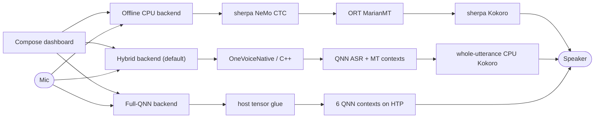

# OneVoice Link

> **Offline, on-device Speech-to-Speech Translation (S2ST) for Android**, with CPU, Qualcomm® QNN/Hexagon™ and hybrid execution paths.

**Submitted to the OneVoice AI Challenge 2026.**

OneVoice Link turns a Snapdragon® phone into an offline interpreter. The complete path is `AudioRecord` → energy VAD → NeMo CTC ASR → MarianMT → Kokoro TTS → `AudioTrack`; it runs locally without network or cloud. Hybrid mode is the VI→EN default: ASR and translation execute on Hexagon HTP, while Kokoro renders the complete translated sentence on CPU for smooth speech.

---

## Runtime paths

| Path | Current capability |
|---|---|
| **Hybrid (default)** | Complete VI→EN: QNN ASR + MarianMT on HTP, followed by whole-utterance CPU Kokoro. This is the recommended listening path. |
| **Offline CPU** | Complete VI→EN / EN→VI ASR → MT → TTS reference pipeline. Only one direction is resident; queues and audio buffers are bounded. |
| **Full QNN** | Complete six-stage VI→EN execution on HTP. Fixed-window Kokoro decoding requires host bucketing and currently has audible seam/continuity limitations. |

---

## Architecture at a glance



Full details in [`docs/ARCHITECTURE.md`](docs/ARCHITECTURE.md).

---

## Repository layout

```text
onevoice-link-native/
|-- android-app/            Jetpack Compose app (Kotlin DSL, Gradle version catalog)
|   `-- app/src/main/
|       |-- java/com/onevoice/link/
|       |   |-- MainActivity.kt          M3 dashboard + runtime permissions + lifecycle
|       |   |-- core/OneVoiceNative.kt   JNI bridge to the native core
|       |   |-- core/NpuEngine.kt        per-stage cascade loading + status
|       |   |-- core/NpuManifest.kt      parses assets/npu_manifest.json
|       |   `-- hf/                      runnable ASR / MarianMT / Kokoro backend
|       |-- assets/npu_manifest.json     stage -> .bin + exact QNN graph name
|       |-- jniLibs/arm64-v8a/           extra prebuilt libs (QNN staged here by Gradle)
|       `-- AndroidManifest.xml          RECORD_AUDIO + Bluetooth (P2P) permissions
|-- native-core/            The C++ realtime engine -> libonevoice_core.so
|   |-- CMakeLists.txt
|   |-- include/            audio_engine.h, ring_buffer.h, qnn_runtime.h
|   |-- src/                main_jni.cpp, audio_engine.cpp, ring_buffer.cpp, qnn_runtime.cpp
|   `-- third_party/
|       |-- oboe/           Google Oboe (committed, built from source)
|       `-- qnn_sdk/        Qualcomm QNN SDK (VENDORED LOCALLY, NOT committed; see below)
|-- onevoice-npu-bins/      QNN context binaries from the model team (~5.9 GB, NOT committed)
|-- models-hf/              converted offline artifacts (NOT committed)
|-- tools/models/           push-hf-models.sh, push-npu-models.sh, conversion/manifest tools
`-- docs/                   Architecture, build, JNI API, QNN integration, NPU deploy
```

> **Deploying to a phone:** Hybrid needs the QNN ASR/MT artifacts plus a Kokoro
> CPU model; `push-npu-models.sh` stages the complete VI→EN bundle. Use
> `push-hf-models.sh` for the bidirectional CPU reference path. See
> [`docs/NPU_DEPLOY.md`](docs/NPU_DEPLOY.md).

---

## Quick start

**Prerequisites:** Android Studio (or CLI) with SDK Platform **36**, NDK **26-29**, CMake **3.22.1**, and a JDK **17+**. Target device: an **arm64-v8a Snapdragon** phone with a Hexagon NPU.

1. **Vendor the QNN SDK.** The Qualcomm AI Runtime SDK is *not* committed (large, license-restricted). Extract it so that these paths exist:
   ```
   native-core/third_party/qnn_sdk/include/QNN/
   native-core/third_party/qnn_sdk/lib/aarch64-android/
   ```
   Without it, the core still compiles in **stub mode** (via `__has_include` guards) so wiring can be exercised on any toolchain.

2. **Build the debug APK:**
   ```bash
   cd android-app
   ./gradlew :app:assembleDebug
   ```

3. **Install & run:**
   ```bash
   ./gradlew :app:installDebug
   cd ..
   tools/models/push-npu-models.sh vi-en R5CW72TP4EP
   ```
   Grant microphone permission, leave **Hybrid** selected, tap **Load**, then **Start Translating**.

See [`docs/BUILD.md`](docs/BUILD.md) for the full toolchain matrix, build flags, and troubleshooting.

---

## Documentation

| Document | Contents |
|---|---|
| [docs/ARCHITECTURE.md](docs/ARCHITECTURE.md) | Threading model, data flow, latency budget, the lock-free ring buffer. |
| [docs/BUILD.md](docs/BUILD.md) | Toolchain, QNN vendoring, Gradle <-> CMake binding, compiler flags, troubleshooting. |
| [docs/JNI_API.md](docs/JNI_API.md) | The native ABI contract and the Kotlin bridge (`OneVoiceNative`). |
| [docs/QNN_INTEGRATION.md](docs/QNN_INTEGRATION.md) | QNN SDK layout, packaging `.so` into the APK, and the runtime `dlopen` chain. |
| [docs/MODEL_HANDOFF.md](docs/MODEL_HANDOFF.md) | Contract for the AI/model team: everything to deliver alongside the `.bin`. |
| [docs/OFFLINE_PIPELINE.md](docs/OFFLINE_PIPELINE.md) | Runnable pipeline, per-direction model layout and safe deployment. |
| [QNN 0x36b1 incident](docs/incidents/2026-08-08-qnn-0x36b1-fastrpc-linker-policy.md) | FastRPC linker-policy root cause, fix and testsig/signing lessons. |

---

## Project status

- ✅ **Builds green** — `./gradlew :app:assembleDebug` produces a signed-debug APK for `arm64-v8a`.
- ✅ **Runnable offline S2ST** — Hybrid VI→EN and CPU VI→EN / EN→VI produce transcript, translation, Kokoro waveform and replay entirely on device.
- ✅ **QNN execution** — unsigned-PD FastRPC and `graphExecute` are working on SM8550/v73. Full QNN runs ASR, MT, Kokoro encoder, W8A8 prosody and decoder as six HTP contexts; its frontend uses exact eSpeak tokenization through a tiny bridge model.
- ✅ **Hybrid default** — QNN ASR/MT feed whole-utterance CPU Kokoro, avoiding the audible seams of the fixed 25-frame QNN decoder.
- 🚧 **Full-QNN TTS quality** — for the same test sentence, synthesis took about 1.2 s over three QNN buckets versus about 2.7 s in Hybrid. Playback delivered all frames, but QNN bucket seams remain less smooth than continuous CPU Kokoro.

See the roadmap notes in [docs/QNN_INTEGRATION.md](docs/QNN_INTEGRATION.md#status--roadmap).

---

## License

See [LICENSE](LICENSE). Google Oboe is Apache-2.0. The Qualcomm QNN / AI Runtime SDK is subject to Qualcomm's own license and is not redistributed in this repository.
