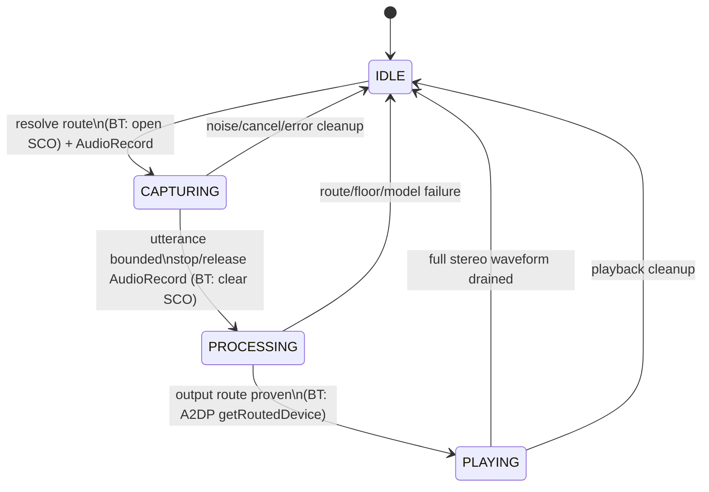

# Architecture

OneVoice Link is an on-device, utterance-bounded VI↔EN speech translator for
two people taking turns, either on one shared stereo TWS pair (one bud each) or
on the phone's own microphone and loudspeaker. The only user-facing backend is
**Hybrid**: ASR encoders and MarianMT run on Hexagon HTP, while the RNN-T
decoder/joiner, greedy CTC decoding and whole-utterance TTS run on the CPU.
Kotlin owns capture, routing, inference orchestration and playback. The native
library provides QNN graph execution, the deterministic ASR feature frontends
and the sea-g2p JNI shim; the old native Oboe cascade is not on the live path.

The production defaults are **dual-ASR confidence routing** and strict
**half-duplex audio**. SpeechFlow remains packaged behind a build-time A/B flag,
but it is not the default and there is no backend or routing-mode selector in
the UI. The only audio choice the user makes is the device route (Auto, Phone or
Bluetooth); it never selects the translation direction.

## Current component map

```mermaid
flowchart LR
  Mic([TWS mic over SCO<br/>or phone mic]) --> Capture["AudioRecord + Silero VAD<br/>one bounded turn"]
  Capture --> Frontend["Kaldi fbank<br/>FP32 [1,1000,80]"]
  Capture --> NemoFront["NeMo log-mel<br/>UFIXED_16 [1,1000,80]"]

  Frontend --> VIEnc["GIPFormer VI encoder<br/>graph_oa00nu3e / HTP"]
  NemoFront --> ENEnc["Parakeet-TDT-CTC-110M EN<br/>graph model / HTP"]
  VIEnc --> VIDec["VI RNN-T decoder/joiner<br/>CPU"]
  ENEnc --> ENDec["EN greedy CTC<br/>CPU"]
  VIDec --> Router["Length-normalized<br/>confidence router"]
  ENDec --> Router

  Router -->|VI selected| VIMT["VI→EN MarianMT<br/>encoder + decoder / HTP"]
  Router -->|EN selected| ENMT["EN→VI MarianMT<br/>encoder + decoder / HTP"]
  VIMT --> ENTTS["Kokoro EN<br/>whole utterance / CPU"]
  ENMT --> VITTS["VieNeu-TTS Nano VI<br/>(Kokoro VI / Supertonic-3 by flag)<br/>whole utterance / CPU"]
  ENTTS --> Right["Stereo AudioTrack<br/>BT: EN target = right"]
  VITTS --> Left["Stereo AudioTrack<br/>BT: VI target = left"]
  Right --> Out([TWS pair over A2DP<br/>or loudspeaker, both channels])
  Left --> Out
```



| Layer | Main files | Responsibility |
|---|---|---|
| UI and lifecycle | `MainActivity.kt`, `ui/OneVoiceApp.kt`, `ui/screens/{Dashboard,Demo,Settings}Screen.kt` | One Hybrid engine, permissions and lifecycle. Dashboard: load, start/stop, audio route, last turn's text. Live demo: offline/memory vitals, live phase, per-turn timings, session export. Settings: headset inventory and saved VI/EN preferences, which never select direction. |
| Audio/state | `core/NpuEngine.kt`, `core/HalfDuplexCoordinator.kt`, `core/AudioRoute.kt` | Route resolution, capture, half-duplex ownership, output route proof and stereo playback. |
| Utterance bounding | `core/UtteranceSegmenter.kt`, `core/SpeechActivityDetector.kt` | Silero (or legacy RMS) frame labels, pre-roll, hangover, echo guard, 10 s ceiling (LEGACY turns). ADAPTIVE turns use `core/TurnSegmenter.kt` and `core/LongTurnCoordinator.kt`. |
| Routing | `core/AutoHybridPipeline.kt`, `core/DualAsrRouter.kt`, `core/RoutingConfig.kt`, `core/ParakeetCtc.kt` | Runs both ASRs, compares normalized confidence, applies the turn prior and fail-closed rules. |
| CPU model glue | `core/NpuPipeline.kt`, `core/ZipformerFamilyRnntDecoder.kt`, `core/CpuTtsEngine.kt`, `core/VieNeuNanoTts.kt`, `core/SeaG2p.kt`, `core/CpuFallbackBranch.kt` | RNN-T decode/join, Marian host glue, whole-utterance TTS and cold whole-utterance recovery. |
| Evidence | `core/SessionRecorder.kt`, `core/TurnReport.kt`, `core/DeviceVitals.kt`, `core/BenchControlReceiver.kt`, `core/BenchTelemetry.kt` | Session JSONL, demo-screen figures, benchmark/eval control surface. |
| JNI bridge | `core/OneVoiceNative.kt`, `native-core/src/main_jni.cpp` | Mirrors direct-buffer calls and the exact ASR feature frontends. JNI arity and argument order are an ABI invariant. |
| QNN runtime | `native-core/src/qnn_runtime.cpp` | Owns one backend/device, six resident contexts, direction-qualified graph lookup and serialized `graphExecute`. |

## Utterance boundary and half-duplex ownership

The live path admits exactly one turn at a time:



- `IDLE`: no live turn owns capture or playback.
- `CAPTURING`: playback is absent. The build's `audioInput` mode
  (`AudioInputMode`) picks the microphone: SELECT (default) takes the
  Dashboard's persisted Phone mic / USB-C mic choice (`MicInputPreference`)
  and then behaves as PHONE or USB; PHONE the built-in mic,
  USB only a plugged-in USB-C mic (fail closed without one); both take the
  phone path below and never claim Bluetooth, but their playback moves to a
  connected A2DP headset when exactly one is connected (stereo split), else
  the loudspeaker. DASHBOARD resolves the persisted audio route for
  this turn (`AudioRoutePreference`). Auto uses Bluetooth when exactly one
  communication headset is usable (or Android has already selected one) and
  otherwise the phone; Bluetooth fails closed without an unambiguous headset;
  Phone never claims one. Bluetooth selects Android's communication device and
  `AudioRecord(VOICE_COMMUNICATION)` owns the SCO/LE microphone. Phone prefers
  the built-in mic with `AudioRecord(VOICE_RECOGNITION)` (half-duplex already
  removes the echo AEC would cancel), holds a 300 ms loudspeaker-echo guard and
  rejects a Bluetooth input. Guarded audio runs through Silero (state stays
  warm, the speech latch stays closed) and into the pre-roll ring, so it cannot
  open a turn but an immediate answer keeps its onset. The app verifies
  `AudioRecord.getRoutedDevice()` before accepting samples.
- `PROCESSING`: `AudioRecord` is stopped and released; on the Bluetooth route
  `clearCommunicationDevice()` has closed the app-owned SCO route. ASR, routing,
  MT and TTS execute only in this state. Before content playback, a stereo
  `AudioTrack` starts on 100 ms of silence and its actual `getRoutedDevice()`
  is polled. On Bluetooth the A2DP route must match the captured headset by
  visible address or product name within the timeout, and translated PCM is not
  submitted before that proof succeeds; on the phone route the loudspeaker is
  preferred and an unexpected route is logged. Content is appended behind the
  silence, and drain accounting starts at the silence length.
- `PLAYING`: the completed stereo target waveform drains through A2DP or the
  loudspeaker. Capture cannot reopen until playback returns the turn to `IDLE`.

The capture worker waits for the active turn to finish and the segment queue is
bounded to one. Capture and playback therefore never overlap. Live capture uses
20 ms frames labelled by Silero VAD (32 ms windows, 0.5 onset / 0.35 offset
probability, sherpa-onnx runtime, bundled `assets/vad/silero_vad.onnx`; the
legacy RMS gate via `-PvadMode=ENERGY`, and as the fallback if the Silero asset
fails to load), 300 ms pre-roll and a one-second end hangover;
`core/UtteranceSegmenter.kt` owns this policy without AudioRecord so it is
unit-tested. Ten seconds is a hard forced boundary: there is no 500 ms overlap, no carried tail and no
second segment captured while the first is processing or playing. A forced
boundary sets the turn prior to the same language, because the cut speaker is
expected to continue.

### Long turns (`longTurnMode=ADAPTIVE`, default)

The paragraph above is `LEGACY` (`-PlongTurnMode=LEGACY`). With `ADAPTIVE`, the
default since 2026-11-05, a turn may
run up to `longTurnMaxTurnS` (120 s); the 10 s model ceiling cuts only an ASR
window, never the microphone. The spec and acceptance plan are
`docs/LONG_FORM_SPEECH_IMPLEMENTATION.md`; measured evidence is in
`docs/LONG_FORM_SPEECH_VALIDATION.md`.

- **Capture.** `TurnSegmenter` keeps the legacy onset, pre-roll, echo guard and
  1 s end-of-turn silence, but writes the whole turn into one bounded PCM16
  `TurnArchive` (120 s = 3.84 MB) and emits windows as sample ranges. After 7 s
  a window is cut inside the first pause of at least 160 ms, with no overlap;
  without one it is cut at the 160,000-sample contract (or a shorter gap in its
  second half) with 960 ms of overlap, aligned to the 80 ms CTC/RNN-T frame
  grid. Window cores tile the turn without gaps. When a later window is
  emitted, its left context is widened (in 80 ms steps from its core start) to
  fill the 10 s model input: the HTP graph is fixed-size, so this costs no NPU
  time, and a short final window hears the sentence it ends instead of being
  decoded cold (EV-7496: "or known" read as "no" from a 1.9 s window). Words in
  the context are dropped by the core rule. The detector is reset once per
  turn, and the onset/minimum/RMS floor decides only whether the turn is
  accepted, never drops a quiet stretch in the middle. Live long-turn capture
  uses a 2 s `AudioRecord` buffer and `THREAD_PRIORITY_URGENT_AUDIO`, and logs
  the read lag against `AudioRecord.getTimestamp()`.
- **Inference while capturing.** `LongTurnCoordinator` runs ASR and MT on one
  inference thread and TTS on one TTS thread while the microphone stays open.
  Playback stays absent until capture closed, so the half-duplex invariant is
  unchanged: `CAPTURING` now also hosts background inference, `PROCESSING`
  starts when capture and SCO are closed, `PLAYING` at the first translated
  sample.
- **Routing.** The first window runs dual ASR (or LID) once; the winner's
  hypothesis is reused and the direction is locked for the turn. Later windows
  run only the selected branch. A rejected first window fails the turn closed
  and closes the microphone at once. The turn prior is committed once, after
  the whole turn played: opposite language after a natural end, same language
  after the turn cap. Windows never touch the prior.
- **Merge.** Decoders expose token emission times (CTC run start, 80 ms steps;
  RNN-T encoder frame, 40 ms). `TranscriptAssembler` keeps the words whose first
  token falls in a window's core; words past a forced cut's core wait for the
  next window. Only the one boundary word on each side is reconciled (same text
  within 120 ms), so genuine repeats survive.
- **Translation units.** `TranslationUnitBuilder` releases complete sentences
  where Parakeet (EN) punctuates and text up to a pause cut for GIPFormer (VI,
  no punctuation). Real continuous VI speech rarely yields a pause cut, so once
  open VI text exceeds 24 tokens (first unit of a turn) or 40 (later units),
  a unit is also released at the widest word-onset gap among the boundaries
  giving it half to all of that size (`word_gap`); without this, units only
  split at the token budget (~25 s of speech) and the first one was still
  rendering when the turn ended. Every Marian sentence must fit 96 source tokens counted by
  the real SentencePiece model; longer text is split at a word boundary, never
  truncated. Marian now rejects an over-long input and reports output that hit
  its 128-token cap without EOS; the coordinator splits and retries such a unit.
  A one-window turn is exactly one unit, like the legacy whole-utterance path.
  Before MT, `FillerWords` cuts leading hesitation words ("ừ", "ờ", "à", "uh",
  "um") and skips a unit made only of them (`dropFillerWords`): lavalier noise
  that passed Silero was decoded as "ừ" and spoken as "Yeah." (16 of 32 turns
  in one session). A turn of only fillers ends quietly, with no error and no
  prior change. Answers ("dạ", "vâng", "yes") and trailing particles are kept.
- **Playback.** One `AudioTrack` per turn: the route proof runs as soon as
  capture closed, while the last units are still synthesizing; units are
  appended in order with a 150 ms pause, staged in 100 ms stereo blocks (VI
  left, EN right on Bluetooth). `PreparedAudioQueue` bounds synthesized audio
  by bytes (16 MiB); when full, only the TTS worker waits.
- **Failure.** A selected NPU ASR/MT failure before any audio played
  quarantines that text path and rebuilds the whole turn from the archive on
  CPU recovery (revision bump; nothing earlier is kept). After audio played the
  turn ends as `partial_failure`. TTS/route failures do not trigger CPU text
  recovery.
- **Telemetry.** One `OneVoiceRouting` row per turn (`schema: 2`, legacy fields
  unchanged plus `longTurn`), and `OneVoiceLongTurn` rows per window and unit.
  `latencyMs.firstAudio` is endpoint (speech end + 1 s hangover) to first
  translated sample written.
- **Replay harness.** `cmd=replay` feeds a 16 kHz mono WAV through the same
  capture loop instead of the microphone (`paced` follows the wall clock and
  skips audio while no turn captures, like a closed mic; `fast` is for
  coverage only). `baseline=B0..B3` selects the policy for that replay. See
  `tools/eval/longturn/`.

Every state edge is checked by `HalfDuplexCoordinator`; error paths may return
directly to `IDLE` only as explicit cleanup. `OneVoiceHalfDuplex` logs the turn
id, source/target states, monotonic timestamp, dwell time and reason, together
with SCO setup/close and output-route measurements.

`a2dpRestoreMs` is the end-to-end interval from SCO close (or capture stop on
the phone route) until the media route is finally confirmed, so it includes
ASR/MT/TTS time when inference finishes before the route probe starts. Use `routePollMs` for the active `AudioTrack`
route-confirmation cost; neither field alone exposes Android's hidden internal
SCO-to-A2DP switching instant.

## Dual-ASR routing

For every accepted bounded utterance, the default `DUAL_ASR` router does the
following:

1. Run the deterministic Kaldi-style frontend once into one direct FP32 buffer
   with contract `[1,1000,80]` for the RNN-T branch.
2. Submit both ASR branches to a two-thread host executor:
   - VI: GIPFormer `graph_oa00nu3e` on HTP, then its RNN-T decoder/joiner on CPU.
   - EN: Parakeet-TDT-CTC-110M (CTC head; sherpa-onnx SM8550 10 s binary,
     graph `model`). Its task computes NeMo log-mel from the same PCM,
     quantizes it with the manifest's UFIXED_16 scale/offset, executes on HTP
     and greedy-decodes the quantized log-softmax output on CPU.
3. For each hypothesis, accumulate the log-probability of every emitted
   lexical token, excluding blank and unknown (CTC: one term per token run, its
   peak frame). Log the raw sum, emitted-token count and
   `normalizedLogProb = rawLogProb / tokenCount`. An empty hypothesis has no
   finite normalized score. `dualAsrEnOffset` is added to the EN score before
   the policy below, because CTC peak scores run closer to zero.
4. Apply the configured decision policy:
   - If **both** normalized scores are below the floor, fail closed.
   - Otherwise, if `abs(vi - en) >= margin`, select the higher-scoring branch.
   - If the margin is insufficient and there is no prior yet, fail closed.
   - Otherwise shift the score difference by `dualAsrPriorWeight` toward the
     expected language and take its sign (reason `soft_margin` when the scores
     overrule the prior, `prior` otherwise). A hard prior used to discard real
     score leads and, once out of phase, kept every later ambiguous turn wrong.
     The expected language is the opposite of the last successfully translated
     turn, or the same language after a forced 10-second boundary (the cut
     speaker continues).
5. Reuse the selected ASR transcript for MT; do not execute its encoder a second
   time. An empty selected transcript is rejected (reason `floor`). The prior
   advances only after a non-empty translation.

The settings live in `android-app/gradle.properties` and are embedded in the
APK's `BuildConfig` (and echoed in every session-log header), rather than hidden
in decoder code:

```properties
routingMode=DUAL_ASR
dualAsrMarginThreshold=0.15
dualAsrFloorThreshold=-5.0
dualAsrEnOffset=-0.08
dualAsrPriorWeight=0.15
```

Override any of them per build with `-P<name>=<value>`. These defaults were fit
on 21 synthetic on-device fixtures and are provisional. Length normalization
removes the obvious short-hypothesis bias, but VI (RNN-T) and EN (CTC) are
different model families with different token vocabularies, so their per-token
log-probabilities are not automatically calibrated against one another; the EN
offset is only a linear intercept. Tune the margin, offset and floor from
labeled real-speaker `OneVoiceRouting` rows before treating any threshold as a
production acceptance boundary. On the 200-utterance organiser dataset the
router selected the right branch for 100/100 VI and 91/100 EN utterances
(`docs/proposal/evidence/P3_ket-qua-do_2026-11-02.md`).

If either routing ASR branch fails, the comparison is incomplete and the turn
fails closed. CPU failover is deliberately not used to invent a confidence for
that branch. After a direction has been selected, a primary Marian text-path
failure quarantines that direction's NPU text path and cold-loads that
direction's CPU recovery branch (`CpuFallbackBranch`: sherpa-onnx NeMo CTC ASR
plus ONNX Runtime Marian, staged under `<direction>/fallback/`). Recovery is
atomic: CPU ASR and MT restart from the original
bounded PCM, never from partial NPU output. A failure of both paths also fails
closed.

### SpeechFlow A/B mode

`-ProutingMode=LID` selects the retained SpeechFlow language identifier for an
A/B build. Its TFLite model, labels, frontend JNI entry point and
`tensorflow-lite-select-tf-ops` dependency remain staged. LID selects a
direction first, after which the same Hybrid ASR→MT→TTS branch runs. This is
an experiment flag baked into the APK, not a user-facing mode and not a reason
to unload any of the six QNN contexts. The turn prior is still updated in LID
mode but does not influence the LID decision.

## Six resident QNN contexts and concurrency

Initialization must load exactly these six direction-qualified contexts before
the pipeline becomes ready:

| Direction | ASR encoder | MT encoder | MT decoder |
|---|---|---|---|
| `vi-en` | `vi-en/asr` | `vi-en/mt_encoder` | `vi-en/mt_decoder` |
| `en-vi` | `en-vi/asr` | `en-vi/mt_encoder` | `en-vi/mt_decoder` |

Direction qualification is mandatory because both Marian binaries reuse the
logical graph names `opus_mt_encoder` and `opus_mt_decoder`.

The two ASR host tasks are concurrent, but QNN encoder calls are not. The one
`QnnRuntime` owns a global `executionMutex`, and every `graphExecute` is
serialized so shared profiling state and context lifecycle remain safe. In
practice, the second HTP encoder can overlap the first branch's CPU RNN-T decode;
the two encoder graphs do not execute simultaneously on HTP. This design leaves
`qnn_runtime.cpp` unchanged and does not claim unsupported QNN concurrency.

`OneVoiceNpu` writes memory snapshots after all six contexts load and again
after CPU host glue is ready. Each row includes `contexts=6`, PSS, RSS and
`peak_rss_kb` (`VmHWM`) plus device memory headroom. These are app-process
figures; DSP-private allocations require separate device telemetry.

## Target speech and channel output

TTS is whole-utterance on the CPU by design: one call per translated turn keeps
prosody continuous across the sentence. The old fixed-window QNN Kokoro path is
historical evidence only. The engine is fixed per APK:

| Target | Engine (`-PviTtsEngine`) | Notes |
|---|---|---|
| English (`vi-en`) | Kokoro-82M EN via sherpa-onnx | `-PkokoroThreads=4`. |
| Vietnamese (`en-vi`), default | VieNeu-TTS v3 Nano (`VIENEU`) | 48M-parameter flow matching: four ONNX graphs (text encoder, duration predictor, vector estimator, codec decoder) on ONNX Runtime Java; sea-g2p (Rust) normalises text and phonemizes it through the `sea_g2p_jni` shim; 16 Euler steps with CFG 3.0 and a fixed seed, so a given text always renders the same waveform. 24 kHz. Staged under `en-vi/tts_vieneu/`; needs `libsea_g2p_rs.so` from `tools/models/build-sea-g2p-android.sh`. |
| Vietnamese, A/B | Kokoro VI (`KOKORO`) | espeak-ng `vi` phonemes through the aliased `tools/models/kokoro-vi-espeak-tokens.txt`; never the upstream token table. |
| Vietnamese, A/B | Supertonic-3 int8 (`SUPERTONIC`) | Graphemes, NFKD-normalised first; 44.1 kHz band-limited resampled to 24 kHz; `supertonicSpeed=1.15`. Random per call. |

`NpuPipeline.synthesize` returns one mono waveform at 24 kHz and trims leading
and trailing silence for VieNeu and Supertonic (lead silence is pure
time-to-first-audio). VieNeu was chosen as the default because on the 91
translated EN→VI dataset turns it was the most intelligible (Whisper round-trip
WER 1.8% vs Kokoro 6.4%, Supertonic 5.3%) and the fastest (first-audio p50
3.06 s vs 4.30 s and 4.22 s) at Kokoro-level memory.

On the Bluetooth route, playback converts the waveform to interleaved stereo
float PCM and fills the unused channel with zero:

| Source direction | Target speech | Channel |
|---|---|---|
| `en-vi` | Vietnamese | left |
| `vi-en` | English | right |

This mapping targets the left and right buds of one stereo TWS pair. It is not a
claim that Android can identify which bud supplied the microphone, nor does it
route two independent streams to two unrelated Bluetooth headsets. On the phone
route both channels carry the waveform, because one loudspeaker is shared by
both people and a channel split would only lose energy.

## Structured tuning data

`OneVoiceRouting` emits one JSON object for every bounded utterance, including
rejected/error turns. It records:

- wall-clock timestamp, turn id, audio duration, audio route (`phone` or
  `bluetooth`), routing mode and the embedded thresholds;
- VI and EN raw log-probability, emitted-token count, normalized score and
  branch latency (LID language/confidence/margin in LID builds);
- prior, decision, normalized margin, decision reason (`margin`,
  `soft_margin`, `prior`, `floor`, `no_prior`, `asr_failure`, `lid`,
  `lid_rejected`, or `pipeline_error`), execution path and error;
- stage latency for capture setup, SCO close, queue wait, shared frontend,
  dual-ASR wall time, MT, TTS, A2DP restore, route polling, playback, first
  audio and total post-bound processing.

Use `OneVoiceHalfDuplex` beside those rows to attribute route-switch delay to a
specific state edge. Do not infer model latency from the end-to-end value alone.

### Session log and live demo screen

The same values feed a `TurnReport` per bounded turn. The **Live demo** screen
shows them beside once-a-second `DeviceVitals` (airplane mode / active network,
whether the APK declares `INTERNET`, process RSS and `VmHWM`, device free
memory, thermal status) and the half-duplex phase, so an uncut screen recording
carries its own offline and memory evidence. `firstAudioMs` runs from the
utterance bound (speech end plus the 1 s hangover) to the first translated
sample handed to `AudioTrack`; the hangover is fixed VAD policy and is reported
separately.

`SessionRecorder` appends one JSONL header row (build, device, SoC, routing,
VAD and TTS settings, audio route) and one row per turn (the routing row plus
transcript, translation and target-audio duration) to
`<filesDir>/sessions/session_<timestamp>.jsonl`, flushing every row so a crash
still leaves completed turns on disk. **Export** copies the current file to
`Download/OneVoice/` through MediaStore (no storage permission, no `run-as`);
**New** starts another file. Benchmark and dataset runs write the same row
format, plus a fixture tag, to `<filesDir>/bench/turns/`.

## Measured performance

Organiser 200-utterance dataset on the SM8550 (`R5CW72TP4EP`), network off;
full method and caveats in `docs/proposal/evidence/P3_ket-qua-do_2026-11-02.md`:

| Metric | VI→EN | EN→VI |
|---|---|---|
| Routing correct | 100/100 | 91/100 |
| ASR WER | 1.3% | 11.5% |
| COMET (wmt22-comet-da) | 0.789 | 0.761 (translated turns) |
| First audio p50 after the bound | 3.4 s | 4.3 s Kokoro VI, 3.06 s VieNeu |

Peak app RSS (`VmHWM`) is about 1.7 GB with both directions resident; it does
not include DSP-private memory. TTS is about 80% of time to first audio, so
latency work that does not touch TTS barely moves the total.

## Bluetooth and Auracast boundary

The shared JBL TWS pair is one Android communication endpoint; Android does not
expose a reliable per-bud microphone identity. Connected-headset inventory and
stored language preferences may remain in Settings, but they are not source
language evidence and do not select the ASR branch. Auracast remains a possible
one-to-many output transport; it does not replace dual-ASR source routing, and a
normal APK still cannot identify passive listeners. See
`docs/AURACAST_ROUTING.md`.

## Native and deployment invariants

- Keep the function order and arity in `OneVoiceNative.kt` and `main_jni.cpp`
  synchronized. Audio frames cross JNI only as bounded direct buffers; no JNI
  call belongs in an audio callback.
- `executeCascade()` and the compiled Oboe/ring-buffer implementation are
  legacy, unreachable code. Do not use them to describe or extend Hybrid.
- `hf/HfEngineBackend.kt` (the former emulator/CPU-only backend) is not
  instantiated anywhere. `hf/MarianTranslator.kt` and
  `hf/SentencePieceUnigram.kt` are live: CPU recovery and the HTP Marian host
  tokenizer use them.
- The APK is built for `arm64-v8a` only (Snapdragon 8 Gen 2, Hexagon v73,
  `qnnSocModel` 43). `libsea_g2p_rs.so` is a git-ignored Rust build output
  (`tools/models/build-sea-g2p-android.sh`); it is loaded before the
  `sea_g2p_jni` shim so the shim's `dlopen` resolves it inside the app's
  linker namespace.
- QNN libraries are `dlopen`'d only after `ADSP_LIBRARY_PATH` is set. The
  Hexagon skeleton is extracted as a DSP asset, not linked as an arm64
  `jniLib`.
- Model graph identity and tensor contracts come from `assets/npu_manifest.json`.
  Regenerate it from shipped binaries instead of guessing graph names.
- A `contextCreateFromBinary` 14001/`0x36b1` result is not, by itself, evidence
  that a signed skeleton is required. Inspect the preceding FastRPC and linker
  logs. See `docs/incidents/2026-08-08-qnn-0x36b1-fastrpc-linker-policy.md` and
  `docs/QNN_SIGNED_DSP.md`.
