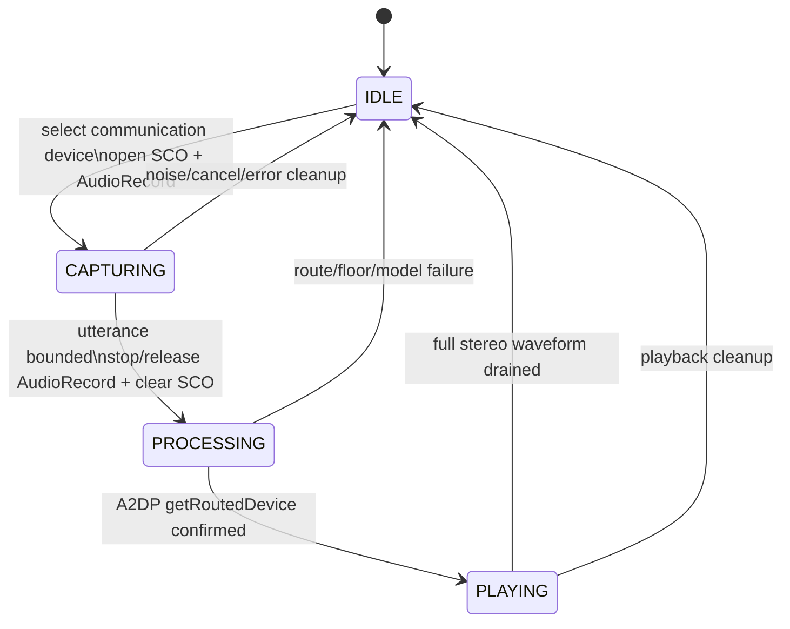

# Architecture

OneVoice Link is an on-device, utterance-bounded VI↔EN speech translator for
one shared stereo TWS pair. The only user-facing backend is **Hybrid**: ASR
encoders and MarianMT run on Hexagon HTP, while RNN-T decoder/joiner sessions and
whole-utterance Kokoro run on the CPU. Kotlin owns capture, routing, inference
orchestration and playback. The native library provides QNN graph execution and
deterministic feature frontends; the old native Oboe cascade is not on the live
path.

The production defaults are **dual-ASR confidence routing** and strict
**half-duplex audio**. SpeechFlow remains packaged behind a build-time A/B flag,
but it is not the default and there is no routing-mode selector in the UI.

## Current component map

```mermaid
flowchart LR
  Mic([Shared TWS mic]) --> Capture["AudioRecord + VAD<br/>SCO, one bounded turn"]
  Capture --> Frontend["Kaldi fbank<br/>FP32 [1,1000,80]"]
  Capture --> NemoFront["NeMo log-mel<br/>UFIXED_16 [1,1000,80]"]

  Frontend --> VIEnc["GIPFormer VI encoder<br/>graph_oa00nu3e / HTP"]
  NemoFront --> ENEnc["Parakeet-TDT-CTC-110M EN<br/>graph model / HTP"]
  VIEnc --> VIDec["VI RNN-T decoder/joiner<br/>CPU"]
  ENEnc --> ENDec["EN greedy CTC<br/>CPU"]
  VIDec --> Router["Length-normalized<br/>confidence router"]
  ENDec --> Router

  Router -->|VI selected| VIMT["VI→EN MarianMT<br/>encoder + decoder / HTP"]
  Router -->|EN selected| ENMT["EN→VI MarianMT<br/>encoder + decoder / HTP"]
  VIMT --> ENTTS["Kokoro EN<br/>whole utterance / CPU"]
  ENMT --> VITTS["Kokoro VI<br/>whole utterance / CPU"]
  ENTTS --> Right["Stereo AudioTrack<br/>EN target = right"]
  VITTS --> Left["Stereo AudioTrack<br/>VI target = left"]
  Right --> Buds([Shared TWS pair])
  Left --> Buds
```



| Layer | Main files | Responsibility |
|---|---|---|
| UI and lifecycle | `MainActivity.kt` | Exposes one Hybrid backend, permissions, lifecycle and completed turn results. |
| Audio/state | `core/NpuEngine.kt`, `core/HalfDuplexCoordinator.kt` | SCO capture, VAD, half-duplex ownership, A2DP route proof and stereo playback. |
| Routing | `core/AutoHybridPipeline.kt`, `core/DualAsrRouter.kt`, `core/RoutingConfig.kt` | Runs both ASRs, compares normalized confidence, applies the turn prior and fail-closed rules. |
| CPU model glue | `core/ZipformerFamilyRnntDecoder.kt`, `core/CpuFallbackBranch.kt`, Kokoro/Marian helpers | RNN-T decode/join, whole-utterance TTS and cold whole-utterance recovery. |
| JNI bridge | `core/OneVoiceNative.kt`, `native-core/src/main_jni.cpp` | Mirrors direct-buffer calls and the exact ASR feature frontends. JNI arity and argument order are an ABI invariant. |
| QNN runtime | `native-core/src/qnn_runtime.cpp` | Owns one backend/device, six resident contexts, direction-qualified graph lookup and serialized `graphExecute`. |

## Utterance boundary and half-duplex ownership

The live path admits exactly one turn at a time:



- `IDLE`: no live turn owns capture or playback.
- `CAPTURING`: playback is absent. The persisted audio route is resolved for
  this turn (`AudioRoutePreference`: Auto, Phone or Bluetooth). Bluetooth
  selects Android's communication device and `AudioRecord(VOICE_COMMUNICATION)`
  owns the SCO/LE microphone. Phone prefers the built-in mic with
  `AudioRecord(VOICE_RECOGNITION)`, drops a 300 ms loudspeaker-echo guard and
  rejects a Bluetooth input. The app verifies `AudioRecord.getRoutedDevice()`
  before accepting samples.
- `PROCESSING`: `AudioRecord` is stopped and released; on the Bluetooth route
  `clearCommunicationDevice()` has closed the app-owned SCO route. ASR, routing,
  MT and TTS execute only in this state. Before content playback, a stereo
  `AudioTrack` starts on 100 ms of silence and its actual `getRoutedDevice()`
  is polled. On Bluetooth the A2DP route must match the captured headset by
  visible address or product name within the timeout, and translated PCM is not
  submitted before that proof succeeds; on the phone route the loudspeaker is
  preferred and an unexpected route is logged. Content is appended behind the
  silence, and drain accounting starts at the silence length.
- `PLAYING`: the completed stereo target waveform drains through A2DP. Capture
  cannot reopen until playback returns the turn to `IDLE`.

The capture worker waits for the active turn to finish and the segment queue is
bounded to one. Capture and playback therefore never overlap. Live capture uses
20 ms frames labelled by Silero VAD (32 ms windows with onset/offset
hysteresis, sherpa-onnx runtime, bundled `assets/vad/silero_vad.onnx`), 300 ms
pre-roll and a one-second end hangover. Ten seconds is
a hard forced boundary: there is no 500 ms overlap, no carried tail and no
second segment captured while the first is processing or playing. A forced
boundary sets the turn prior to the same language, because the cut speaker is
expected to continue.

Every state edge is checked by `HalfDuplexCoordinator`; error paths may return
directly to `IDLE` only as explicit cleanup. `OneVoiceHalfDuplex` logs the turn
id, source/target states, monotonic timestamp, dwell time and reason, together
with SCO setup/close and A2DP restore measurements.

`a2dpRestoreMs` is the end-to-end interval from SCO close until the media route
is finally confirmed, so it includes ASR/MT/TTS time when inference finishes
before the route probe starts. Use `routePollMs` for the active `AudioTrack`
route-confirmation cost; neither field alone exposes Android's hidden internal
SCO-to-A2DP switching instant.

## Dual-ASR routing

For every accepted bounded utterance, the default `DUAL_ASR` router does the
following:

1. Run the deterministic Kaldi-style frontend once into one direct FP32 buffer
   with contract `[1,1000,80]` for the RNN-T branch.
2. Submit both ASR branches to a two-thread host executor:
   - VI: GIPFormer `graph_oa00nu3e` on HTP, then its RNN-T decoder/joiner on CPU.
   - EN: Parakeet-TDT-CTC-110M (CTC head; sherpa-onnx SM8550 10 s binary,
     graph `model`). Its task computes NeMo log-mel from the same PCM,
     quantizes it with the manifest's UFIXED_16 scale/offset, executes on HTP
     and greedy-decodes the quantized log-softmax output on CPU.
3. For each hypothesis, accumulate the log-probability of every emitted
   lexical token, excluding blank and unknown (CTC: one term per token run, its
   peak frame). Log the raw sum, emitted-token count and
   `normalizedLogProb = rawLogProb / tokenCount`. An empty hypothesis has no
   finite normalized score. `dualAsrEnOffset` is added to the EN score before
   the policy below, because CTC peak scores run closer to zero.
4. Apply the configured decision policy:
   - If **both** normalized scores are below the floor, fail closed.
   - Otherwise, if `abs(vi - en) >= margin`, select the higher-scoring branch.
   - If the margin is insufficient and there is no prior yet, fail closed.
   - Otherwise shift the score difference by `dualAsrPriorWeight` toward the
     expected language and take its sign. The expected language is the
     opposite of the last successfully translated turn, or the same language
     after a forced 10-second boundary (the cut speaker continues).
5. Reuse the selected ASR transcript for MT; do not execute its encoder a second
   time.

The settings live in `android-app/gradle.properties` and are embedded in the
APK's `BuildConfig`, rather than hidden in decoder code:

```properties
routingMode=DUAL_ASR
dualAsrMarginThreshold=0.15
dualAsrFloorThreshold=-5.0
dualAsrEnOffset=-0.08
dualAsrPriorWeight=0.15
kokoroThreads=4
vadMode=SILERO
```

Override them per build with `-ProutingMode=...`,
`-PdualAsrMarginThreshold=...` and `-PdualAsrFloorThreshold=...`. These defaults
are provisional. Length normalization removes the obvious short-hypothesis
bias, but VI and EN use different token vocabularies, so their per-token
log-probabilities are not automatically calibrated against one another. Tune
the margin and floor from labeled on-device `OneVoiceRouting` rows before
treating either threshold as a production acceptance boundary.

If either routing ASR branch fails, the comparison is incomplete and the turn
fails closed. CPU failover is deliberately not used to invent a confidence for
that branch. After a direction has been selected, a primary Marian text-path
failure quarantines that direction's NPU text path and cold-loads the existing
CPU fallback. Recovery is atomic: CPU ASR and MT restart from the original
bounded PCM, never from partial NPU output. A failure of both paths also fails
closed.

### SpeechFlow A/B mode

`-ProutingMode=LID` selects the retained SpeechFlow language identifier for an
A/B build. Its TFLite model, labels, frontend JNI entry point and
`tensorflow-lite-select-tf-ops` dependency remain staged. LID selects a
direction first, after which the same Hybrid ASR→MT→TTS branch runs. This is
an experiment flag baked into the APK, not a user-facing mode and not a reason
to unload any of the six QNN contexts.

## Six resident QNN contexts and concurrency

Initialization must load exactly these six direction-qualified contexts before
the pipeline becomes ready:

| Direction | ASR encoder | MT encoder | MT decoder |
|---|---|---|---|
| `vi-en` | `vi-en/asr` | `vi-en/mt_encoder` | `vi-en/mt_decoder` |
| `en-vi` | `en-vi/asr` | `en-vi/mt_encoder` | `en-vi/mt_decoder` |

Direction qualification is mandatory because both Marian binaries reuse the
logical graph names `opus_mt_encoder` and `opus_mt_decoder`.

The two ASR host tasks are concurrent, but QNN encoder calls are not. The one
`QnnRuntime` owns a global `executionMutex`, and every `graphExecute` is
serialized so shared profiling state and context lifecycle remain safe. In
practice, the second HTP encoder can overlap the first branch's CPU RNN-T decode;
the two encoder graphs do not execute simultaneously on HTP. This design leaves
`qnn_runtime.cpp` unchanged and does not claim unsupported QNN concurrency.

`OneVoiceNpu` writes memory snapshots after all six contexts load and again
after CPU host glue is ready. Each row includes `contexts=6`, PSS, RSS and
`peak_rss_kb` (`VmHWM`) plus device memory headroom. These are app-process
figures; DSP-private allocations require separate device telemetry.

## Target-channel output

Kokoro produces one continuous mono waveform. Playback converts it to
interleaved stereo float PCM and fills the unused channel with zero:

| Source direction | Target speech | Channel |
|---|---|---|
| `en-vi` | Vietnamese | left |
| `vi-en` | English | right |

This mapping targets the left and right buds of one stereo TWS pair. It is not a
claim that Android can identify which bud supplied the microphone, nor does it
route two independent streams to two unrelated Bluetooth headsets.

## Structured tuning data

`OneVoiceRouting` emits one JSON object for every bounded utterance, including
rejected/error turns. It records:

- wall-clock timestamp, turn id, audio duration and routing mode;
- VI and EN raw log-probability, emitted-token count, normalized score and
  branch latency;
- prior, decision, normalized margin, decision reason (`margin`, `prior`,
  `floor`, `no_prior`, `asr_failure`, or LID reason), execution path and error;
- stage latency for capture setup, SCO close, queue wait, shared frontend,
  dual-ASR wall time, MT, TTS, A2DP restore, route polling, playback and total
  post-bound processing.

Use `OneVoiceHalfDuplex` beside those rows to attribute route-switch delay to a
specific state edge. Do not infer model latency from the end-to-end value alone.

## Bluetooth and Auracast boundary

The shared JBL TWS pair is one Android communication endpoint; Android does not
expose a reliable per-bud microphone identity. Connected-headset inventory and
stored language preferences may remain in Settings, but they are not source
language evidence and do not select the ASR branch. Auracast remains a possible
one-to-many output transport; it does not replace dual-ASR source routing, and a
normal APK still cannot identify passive listeners. See
`docs/AURACAST_ROUTING.md`.

## Native and deployment invariants

- Keep the function order and arity in `OneVoiceNative.kt` and `main_jni.cpp`
  synchronized. Audio frames cross JNI only as bounded direct buffers; no JNI
  call belongs in an audio callback.
- `executeCascade()` and the compiled Oboe/ring-buffer implementation are
  legacy, unreachable code. Do not use them to describe or extend Hybrid.
- QNN libraries are `dlopen`'d only after `ADSP_LIBRARY_PATH` is set. The
  Hexagon skeleton is extracted as a DSP asset, not linked as an arm64
  `jniLib`.
- Model graph identity and tensor contracts come from `assets/npu_manifest.json`.
  Regenerate it from shipped binaries instead of guessing graph names.
- A `contextCreateFromBinary` 14001/`0x36b1` result is not, by itself, evidence
  that a signed skeleton is required. Inspect the preceding FastRPC and linker
  logs. See `docs/incidents/2026-08-08-qnn-0x36b1-fastrpc-linker-policy.md` and
  `docs/QNN_SIGNED_DSP.md`.
