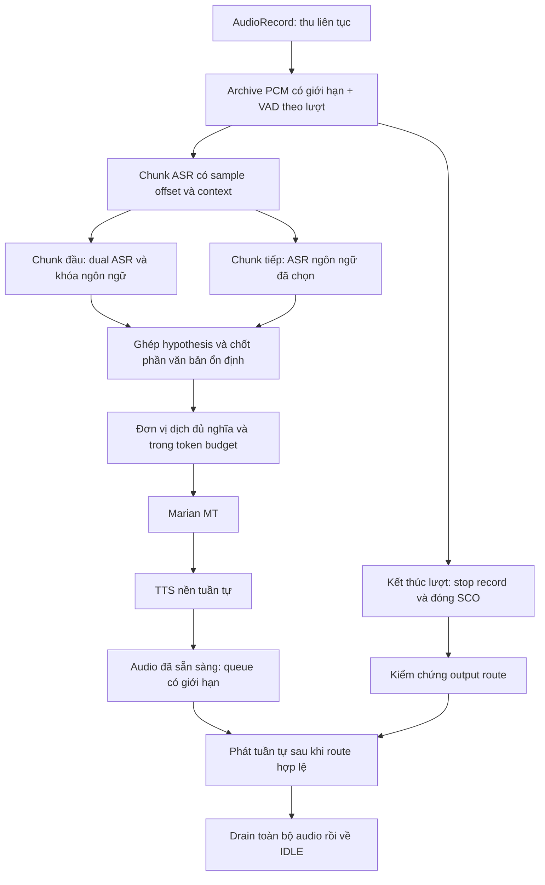

# Triển khai nhận dạng và dịch lượt nói dài trên OneVoice Link

Ngày lập: 2026-11-04. Code được đối chiếu tại commit `6953db9a2e96df85a39d8acf858b9d5291b4c825`.

Trạng thái: **đặc tả triển khai và kiểm chứng, chưa phải tính năng đã hoàn thành**.

## 1. Nhiệm vụ dành cho Claude

Hãy triển khai hỗ trợ lượt nói dài hơn 10 giây, kiểm thử toàn bộ đường chạy và tối ưu trên thiết bị Snapdragon 8 Gen 2 của dự án. Dùng tài liệu này làm hợp đồng hành vi và kế hoạch nghiệm thu. Đọc lại code trước khi sửa vì repository có thể đã tiến xa hơn commit tham chiếu.

Mục tiêu là không mất phần lời nói tiếp diễn do ứng dụng dừng microphone ở ranh giới chunk, giảm thời gian chờ bản dịch sau khi người nói dừng, giữ chất lượng nội dung và vận hành ổn định khi thiết bị nóng. “Tối ưu” phải được chứng minh bằng số đo và so sánh chất lượng; không đồng nghĩa tăng thread, giữ HTP ở turbo hay tuyên bố độ trễ bằng 0.

Thứ tự ưu tiên khi có đánh đổi:

1. Đủ audio trong phạm vi lượt được chấp nhận; đúng thứ tự; không phát sai hướng/ngôn ngữ; không phát lại đoạn đã phát.
2. Độ chính xác ASR, đầy đủ ý nghĩa bản dịch, độ rõ và tự nhiên của TTS.
3. Capture ổn định, RAM có giới hạn, không lỗi lifecycle, hiệu năng duy trì khi chạy lâu.
4. Độ trễ phản hồi p50/p95, sau đó điện năng và tài nguyên.

Thực hiện đến mức có code, kiểm thử, cấu hình được chọn và báo cáo bằng chứng. Nếu không có điện thoại/model/SDK/dataset, hoàn thành các phần độc lập có thể làm và ghi rõ phần chưa kiểm chứng; không gán PASS cho kiểm thử phần cứng chưa chạy. Không thay đổi công việc không liên quan đang có trong checkout.

## 2. Phạm vi và các thay đổi có chủ đích

Trong đợt này:

- Giữ các QNN context ASR có đầu vào tối đa 160.000 mẫu, không re-export model 20–30 giây.
- Giữ backend Hybrid, VI↔EN, sáu context QNN và audio half-duplex.
- Cho phép inference chạy **trong lúc CAPTURING**. Capture và playback vẫn tuyệt đối không đồng thời.
- Một lượt nói gồm nhiều chunk ASR; chunk không còn đồng nghĩa với lượt hội thoại.
- Dịch và tổng hợp trước các đơn vị văn bản đã ổn định, đủ ngữ nghĩa; phát sau khi kết thúc lượt.
- Hỗ trợ mục tiêu 120 giây liên tục mỗi lượt ở cấu hình đầu tiên; có giới hạn và thông báo rõ nếu chạm trần. Tách giới hạn này khỏi giới hạn 10 giây của model.
- Giữ nguyên inference offline. Phân phối model qua Hugging Face/APK không thuộc công việc này.

Các mô tả hiện tại trong `CLAUDE.md`/`ARCHITECTURE.md` rằng inference chỉ chạy ở PROCESSING, một turn chỉ chứa một chunk, và TTS một lần cho toàn lượt sẽ được cập nhật có chủ đích. TTS vẫn chạy nguyên một **đơn vị dịch đủ nghĩa**, không bị chặt thành cửa sổ âm thanh cố định. Các invariant về route, JNI, QNN lifecycle và fail-closed tiếp tục được giữ.

Chưa thuộc phạm vi bắt buộc: full-duplex, nhận dạng người nói theo từng tai nghe, hỗ trợ tùy ý code-switch trong cùng lượt, thay model streaming, huấn luyện lại, bỏ mutex QNN hoặc thêm backend UI. Không trộn các nghiên cứu này vào việc nghiệm thu phiên bản dùng model hiện tại.

## 3. Bản đồ code cần đọc

Repository root trong workspace hiện tại: `/media/Data/MyDocuments/D/GreenNode/onevoice-link-native`.

| Nguồn | Phần cần hiểu/sửa |
|---|---|
| [CLAUDE.md](/media/Data/MyDocuments/D/GreenNode/onevoice-link-native/CLAUDE.md), [ARCHITECTURE.md](/media/Data/MyDocuments/D/GreenNode/onevoice-link-native/docs/ARCHITECTURE.md) | Contract và hướng dẫn build; cập nhật sau khi hành vi mới được kiểm chứng |
| [NpuEngine.kt](/media/Data/MyDocuments/D/GreenNode/onevoice-link-native/android-app/app/src/main/java/com/onevoice/link/core/NpuEngine.kt) | `captureLoop`, `captureOneTurn`, `readBoundedUtterance`, `pipelineLoop`, `playStereo`, lifecycle, `benchFeed` |
| [UtteranceSegmenter.kt](/media/Data/MyDocuments/D/GreenNode/onevoice-link-native/android-app/app/src/main/java/com/onevoice/link/core/UtteranceSegmenter.kt) | Pre-roll, echo guard, VAD hangover, hard boundary; hiện trả một `BoundedUtterance` |
| [SpeechActivityDetector.kt](/media/Data/MyDocuments/D/GreenNode/onevoice-link-native/android-app/app/src/main/java/com/onevoice/link/core/SpeechActivityDetector.kt) | Frame capture 20 ms, cửa sổ Silero 32 ms, trạng thái detector |
| [HalfDuplexCoordinator.kt](/media/Data/MyDocuments/D/GreenNode/onevoice-link-native/android-app/app/src/main/java/com/onevoice/link/core/HalfDuplexCoordinator.kt) | Quyền sở hữu microphone/playback, turn ID, cancellation |
| [AutoHybridPipeline.kt](/media/Data/MyDocuments/D/GreenNode/onevoice-link-native/android-app/app/src/main/java/com/onevoice/link/core/AutoHybridPipeline.kt), [DualAsrRouter.kt](/media/Data/MyDocuments/D/GreenNode/onevoice-link-native/android-app/app/src/main/java/com/onevoice/link/core/DualAsrRouter.kt) | Tách routing/ASR/MT; prior theo lượt; tái sử dụng hypothesis đã chọn; CPU recovery |
| [ParakeetCtc.kt](/media/Data/MyDocuments/D/GreenNode/onevoice-link-native/android-app/app/src/main/java/com/onevoice/link/core/ParakeetCtc.kt), [ZipformerFamilyRnntDecoder.kt](/media/Data/MyDocuments/D/GreenNode/onevoice-link-native/android-app/app/src/main/java/com/onevoice/link/core/ZipformerFamilyRnntDecoder.kt) | Alignment và ghép qua chunk; hiện không trả timestamp từng token |
| [NpuPipeline.kt](/media/Data/MyDocuments/D/GreenNode/onevoice-link-native/android-app/app/src/main/java/com/onevoice/link/core/NpuPipeline.kt) | Giới hạn 160.000 mẫu, frontend, buffer dùng chung, Marian 256 token, TTS |
| [VieNeuNanoTts.kt](/media/Data/MyDocuments/D/GreenNode/onevoice-link-native/android-app/app/src/main/java/com/onevoice/link/core/VieNeuNanoTts.kt), [CpuTtsEngine.kt](/media/Data/MyDocuments/D/GreenNode/onevoice-link-native/android-app/app/src/main/java/com/onevoice/link/core/CpuTtsEngine.kt) | VieNeu VI mặc định, Kokoro EN; thread, chunk nội bộ, seed, trimming |
| [qnn_runtime.cpp](/media/Data/MyDocuments/D/GreenNode/onevoice-link-native/native-core/src/qnn_runtime.cpp), [asr_frontend.cpp](/media/Data/MyDocuments/D/GreenNode/onevoice-link-native/native-core/src/asr_frontend.cpp) | Mutex toàn cục, profiling, HTP power vote, frontend shape cố định |
| [BenchControlReceiver.kt](/media/Data/MyDocuments/D/GreenNode/onevoice-link-native/android-app/app/src/main/java/com/onevoice/link/core/BenchControlReceiver.kt), [BenchTelemetry.kt](/media/Data/MyDocuments/D/GreenNode/onevoice-link-native/android-app/app/src/main/java/com/onevoice/link/core/BenchTelemetry.kt) | Lệnh bench, QNN timings, fixture injection; tránh bypass logic mới |
| [TurnReport.kt](/media/Data/MyDocuments/D/GreenNode/onevoice-link-native/android-app/app/src/main/java/com/onevoice/link/core/TurnReport.kt), [SessionRecorder.kt](/media/Data/MyDocuments/D/GreenNode/onevoice-link-native/android-app/app/src/main/java/com/onevoice/link/core/SessionRecorder.kt), [DeviceVitals.kt](/media/Data/MyDocuments/D/GreenNode/onevoice-link-native/android-app/app/src/main/java/com/onevoice/link/core/DeviceVitals.kt) | Schema, thời gian, RAM, nhiệt, UI và session export |
| [tools/eval/README.md](/media/Data/MyDocuments/D/GreenNode/onevoice-link-native/tools/eval/README.md) | Bộ đánh giá 200 utterance hiện có; bổ sung đánh giá long-turn |

Những sự thật phải giữ khi thiết kế:

- Thiết bị đích: arm64, SM8550/kalama, Hexagon v73, `qnnSocModel=43`. Đọc lại thông tin thiết bị thật, không suy ra từ tên điện thoại hoặc serial cũ.
- VI: GIPFormer FP32 `[1,1000,80] → [1,248,512]`; CPU RNN-T decoder/joiner. Bước encoder xấp xỉ 40 ms, có offset do subsampling.
- EN: Parakeet CTC UFIXED16 `[1,1000,80] → [1,125,1025]`; bước encoder **80 ms**, không phải 40 ms. Lấy quantization từ manifest.
- Capture 16 kHz mono, frame 320 mẫu = 20 ms; pre-roll 300 ms; end hangover 1.000 ms. Pre-roll hiện đã nằm trong `currentSize`.
- Mỗi call ASR vẫn cần `1..160000` mẫu gồm tất cả context. Frontend/graph cố định nên chunk ngắn không tự động giảm FLOPs theo tỷ lệ độ dài.
- Sáu QNN context luôn resident. `graphExecute` có mutex dùng chung; hai coroutine không đồng nghĩa hai graph HTP chạy song song.
- VI TTS mặc định hiện là **VieNeu Nano**, không còn Kokoro VI. Tham số ban đầu: 16 steps, CFG 3.0, speed 1.0, 4 threads, seed 1234; EN là Kokoro 4 threads.
- VieNeu đã đặt `session.intra_op.allow_spinning=0`, inter-op 1; không mô tả đây là tối ưu mới. RNN-T CPU dùng 1 thread. Kiểm tra các runtime thực sự được đóng gói trước khi sử dụng API tuning mới.
- Headset là một cặp stereo chung: target VI bên trái, target EN bên phải. Phone phát cả hai kênh. Route không phải bằng chứng ngôn ngữ nguồn.

## 4. Kiến trúc cần triển khai



### 4.1. Tách trạng thái audio và tiến độ xử lý

Giữ trạng thái audio dễ quan sát:

`IDLE → CAPTURING → PROCESSING → PLAYING → IDLE`.

- CAPTURING cho phép ASR/MT/TTS nền, không có playback kể cả prime silence.
- PROCESSING bắt đầu sau khi ngừng thu; hoàn tất route và đợi phần audio đầu nếu chưa sẵn sàng.
- PLAYING cho phép worker hoàn tất phần đuôi, nhưng không cho capture mở lại.
- Chỉ trở về IDLE sau khi producer TTS đã kết thúc **và** mọi sample đã gửi được drain, hoặc đã cleanup một lỗi/cancel có ghi nhận.
- Trạng thái inference là dữ liệu riêng theo chunk/unit; không chuyển audio state sang PROCESSING ở mỗi lần emit chunk.

Một `turnId` duy nhất bao phủ toàn bộ lượt. Mỗi chunk/unit có sequence ID riêng. Thêm session generation để loại kết quả muộn sau Stop/Start. Generation chỉ chặn publish; không thay thế việc đợi native call kết thúc trước khi tái sử dụng/giải phóng buffer.

### 4.2. Hợp đồng dữ liệu

Tên class có thể điều chỉnh theo code thực tế; các thông tin sau là bắt buộc:

- `TurnContext`: turn/session ID, route snapshot, ngôn ngữ đã khóa, start/end reason, trạng thái terminal, raw archive, cancellation.
- `AudioChunk`: chunk ID, `[startSample,endSample)` tuyệt đối trong lượt, phạm vi context trái/phải, nguyên nhân cắt, số mẫu hợp lệ, handle đọc PCM bất biến.
- `TurnEnded`: sự kiện riêng với last speech sample và reason. Có thể không kèm PCM mới.
- `AsrChunkResult`: hypothesis, evidence routing nếu có, alignment theo model, sample range nguồn và execution path.
- `TranscriptUpdate`: phần đã chốt và phần đuôi còn có thể sửa; revision ID; provenance tới audio range.
- `TranslationUnit`: unit ID, source text đã chốt, source ranges, số token thật, lý do chốt, translation revision.
- `PreparedAudio`: unit/revision ID, sample rate, sample count, PCM hoặc handle lưu trữ, thứ tự phát.

Quy ước range nửa mở `[start,end)` ở mọi tầng. Dùng sample index `Long` làm thời gian âm thanh chuẩn, đồng hồ monotonic cho latency. Phần context được phép lặp; phần nội dung được chốt phải tiến về trước và không bị phát lặp.

### 4.3. Ownership và scheduling

- Capture worker chỉ đọc mic, ghi archive, chạy VAD và emit metadata. Không chạy MT/TTS, không chờ inference, không ghi log lớn hoặc làm I/O đĩa đồng bộ trong mỗi frame.
- Trước tiên dùng một inference coordinator sở hữu ASR/MT; giữ dual-ASR worker hiện có cho chunk đầu với ownership rõ. Dùng một TTS worker tuần tự, một playback consumer.
- Sau khi có profiling, có thể nhường giữa các bước Marian để ưu tiên ASR backlog. Marian session vẫn phải có một owner; state decode của từng unit không được ghi đè.
- Không chạy cùng lúc hai call trên một `NpuPipeline`, decoder hoặc translator có mutable buffer. Tách tài nguyên riêng cho TTS nếu muốn overlap với ASR/MT; chứng minh không chung buffer/lifecycle và giữ model session resident.
- Không tạo một coroutine/thread/model session cho mỗi frame/chunk. Không tăng song song HTP bằng cách bỏ mutex.
- Stop/Destroy: dừng producer, đánh dấu generation, ngăn publish mới, thức tỉnh waiter, đợi call native thực sự kết thúc, rồi giải phóng tài nguyên. Không close model khi QNN/ORT đang dùng.
- Kiểm tra cả benchmark/replay control: không cho `synth`, `feed`, đổi profiling/power hoặc release model đua với inference đang chạy. Áp cấu hình ở safe point trong coordinator.

## 5. Chia chunk nhưng giữ nguyên lượt nói

### 5.1. Cấu hình khởi đầu

Đây là **giá trị thử nghiệm**, cần đưa vào cấu hình tập trung và session header; chưa phải cấu hình tối ưu đã đo:

| Tham số | Giá trị khởi đầu | Ràng buộc |
|---|---:|---|
| ASR input hard limit | 160.000 samples | Không được vượt, gồm pre-roll/context/overlap |
| Soft split bắt đầu | 7.000 ms | Đo theo tổng window đang xây dựng; test cả lượt đầu và tiếp theo |
| Micro-pause mục tiêu | 160 ms | Tính bằng số sample/thời gian; không nhầm frame capture với frame Silero |
| Overlap khi boundary không chắc | 960 ms | Mốc thử tương thích grid 80 ms; không coi đây là bảo đảm chất lượng |
| End-of-turn silence | 1.000 ms | Giữ baseline trước; chỉ giảm sau khi đo false endpoint |
| Lượt nói tối đa | 120 s | Tách khỏi model limit; thông báo lý do nếu đạt trần |
| Tổng budget PCM trung gian | 32 MiB | Tính toàn bộ archive, in-flight copies, mono queue và stereo staging; loại model weights khỏi chỉ số này |
| Soft budget audio TTS chờ phát | 16 MiB | Khi đầy, trì hoãn TTS; không block capture và không bỏ unit |

Có thể giảm số tham số nếu không cần, nhưng không rải magic numbers qua nhiều file. Thay đổi window/overlap phải giữ model limit và các bài test coverage.

### 5.2. Thuật toán boundary

1. Bắt đầu lượt theo onset/pre-roll/echo guard hiện có. Detector reset một lần ở đầu lượt, không reset ở mỗi chunk.
2. Ghi audio liên tục vào archive có giới hạn; duy trì VAD, silence count và last speech sample ở cấp lượt.
3. Sau soft minimum, ưu tiên một khoảng non-speech đủ dài. Đặt boundary trong khoảng nghỉ và giữ padding phù hợp; không chỉ cắt ngay khi frame đầu tiên nhỏ tiếng.
4. Nếu đến trần mà không có khoảng nghỉ đáng tin cậy, emit window có overlap với window kế tiếp. Có thể dùng VAD/RMS để xếp hạng boundary, nhưng RMS minimum không được coi là bằng chứng không có tiếng nói.
5. Với boundary chưa chắc, chưa chốt toàn bộ phần cuối hypothesis. Giữ phần đó để xử lý với context của window kế tiếp.
6. Mang đầy đủ phần tail đã thu sau boundary sang window tiếp theo. `accept()` phải xử lý cả phần dư nếu một read băng qua mốc cắt; không vứt mẫu vì `minOf(count, remaining)`.
7. Khi đủ end silence, emit `TurnEnded` độc lập và flush phần tail cuối. Nếu vừa soft-split rồi người dùng im luôn, vẫn phải có terminal event, không cần một lần onset mới.
8. Khi chạm turn/resource limit, ngừng thu có kiểm soát và ghi lý do. Xử lý phần đã chấp nhận, đánh dấu lượt bị giới hạn; không báo đã dịch đầy đủ lời người dùng nói ngoài phạm vi thu.

Không áp lại điều kiện onset/minimum speech/RMS để loại từng chunk giữa một lượt đã được chấp nhận: phần nói nhỏ ở giữa câu vẫn cần được giữ. Trim silence cuối lượt tách khỏi padding/context giữa các chunk. Đếm độ dài silence bằng số mẫu thực nhận, kể cả partial read; test natural EOT trùng thời điểm hard boundary và cap để chỉ phát một terminal event.

Tách ba loại kết thúc: chunk boundary nội bộ, người nói kết thúc, và lượt bị dừng bởi cap/lỗi/cancel. Không tái sử dụng một boolean `forcedBoundary` cho cả ba nghĩa.

Giữ baseline fixed-window + overlap như một đối chứng thực nghiệm. Chỉ chọn adaptive split nếu cải thiện chất lượng/latency thực tế; cắt 7 giây thay cho 9 giây có thể tăng số lượt chạy graph shape cố định.

## 6. Routing và ghép ASR

### 6.1. Routing theo lượt

- Chunk đủ điều kiện đầu tiên chạy dual ASR bằng score policy hiện có; tái sử dụng luôn hypothesis nhánh được chọn. Không chạy lại encoder của nhánh thắng chỉ để lấy transcript.
- Khóa hướng cho phần còn lại của lượt. Giảm một nhánh ASR sau chunk đầu không có nghĩa giảm một nửa tổng tải pipeline.
- Giữ các trường hợp floor/no-prior/branch failure fail-closed. Không khóa ngôn ngữ vào một kết quả bị policy từ chối; không bịa CPU confidence để so sánh.
- Phase đầu: nếu routing bị từ chối, kết thúc lượt có reason rõ, không âm thầm dùng một nhánh. Thử gom thêm evidence là nghiên cứu riêng cần bounded policy và benchmark.
- Prior chỉ commit một lần khi toàn lượt có kết quả dịch hoàn chỉnh hợp lệ. Chunk nội bộ không đổi prior. Natural end kỳ vọng ngôn ngữ đối diện; resource cap có phần dịch hợp lệ kỳ vọng cùng ngôn ngữ; cancel/failure/partial playback không commit.
- LID A/B vẫn hoạt động: chọn ngôn ngữ theo lượt và đi qua coordinator mới; không loại bỏ asset/runtime LID.
- Ngôn ngữ đổi giữa một lượt hoặc hai người chen lời là trường hợp ngoài bảo đảm của language lock. Test và ghi hạn chế; không quảng cáo hỗ trợ dựa trên việc ASR tình cờ ra text.

### 6.2. CTC tiếng Anh

- Giữ frame-level argmax/log-probability hoặc cấu trúc tương đương trước bước collapse, cùng thời gian theo sample index.
- Loại vùng context ở biên và ghép phần frame được giữ; collapse CTC phải nhất quán qua boundary, bao gồm blank và adjacent repeat. Không collapse độc lập rồi chỉ concat token IDs.
- Lập công thức mapping frame → sample đúng frontend và subsampling 8. Đồng bộ grid cửa sổ hoặc có rule căn chỉnh được test; không làm tròn độc lập hai phía rồi gây gap/overlap không chủ ý.
- Dùng valid frame count; không decode phần zero padding của graph. Window cuối phải flush phần tail chưa có right context, window đầu không mất onset.
- Score dùng để routing chunk đầu phải giữ nghĩa cũ; metadata alignment mới không được vô tình thay cách tính confidence.
- Đây là suy luận áp dụng CTC chunking vào binary Parakeet hiện có; phải đo vì padding/normalization mỗi window có thể làm logits khác.

### 6.3. RNN-T tiếng Việt

- Mở rộng kết quả để giữ emitted token ID, encoder frame và score; đổi sang sample range với stride/offset đúng, không giả định 250 frame.
- Emission time là alignment xấp xỉ, không phải word timestamp chuẩn. Ghép dựa trên vùng overlap, thời gian và so khớp token cục bộ; không chạy LCS không giới hạn trên cả transcript.
- Phải giữ các từ lặp thật như “có, có”, “rất rất”, số lặp; không deduplicate chỉ vì hai chuỗi giống nhau.
- Decoder hiện reset context theo mỗi call. Không mang state RNN-T qua window chồng lặp một cách trực tiếp vì có thể đếm lại context; việc đổi decode-state là thí nghiệm riêng.
- Nếu chưa đủ bằng chứng để chốt vùng biên, giữ suffix chưa ổn định tới kết quả kế tiếp. Đặt giới hạn look-back và flush cuối lượt; không để văn bản pending vô hạn.
- Chọn chiến lược bằng tập audio tiếng Việt thật, gồm tên riêng, số, tiếng nói nhỏ và từ nằm ngay boundary. Không đánh dấu “zero word loss” dựa trên test index PCM.

## 7. Đơn vị dịch và TTS nền

### 7.1. Tách chunk ASR khỏi đơn vị MT

Tạo bộ ghép văn bản có hai phần: prefix đã chốt và suffix chưa ổn định. Chỉ prefix đã chốt được đưa vào bộ chọn đơn vị dịch.

Chọn đơn vị dịch theo thứ tự:

1. Câu có dấu kết thúc tin cậy, nếu ASR thực sự cung cấp dấu câu.
2. Mệnh đề/cụm đủ nghĩa kết hợp khoảng nghỉ acoustic và một lượng look-ahead giới hạn.
3. Bắt buộc chia ở ranh giới từ khi gần giới hạn token, hoặc flush tại end-of-turn; ghi rõ `token_budget`/`turn_end` là lý do.

Không mặc định ASR có punctuation. Trong phase đầu, heuristic phải minh bạch, được cấu hình và test; chưa thêm một model punctuation/LLM chỉ để phân đoạn. Không cần đợi toàn lượt, nhưng không biến mọi khoảng lấy hơi 160 ms thành một câu dịch độc lập.

Ví dụ phải thử: “Tôi chỉ đồng ý triển khai phương án này … nếu tất cả điều kiện sau được đáp ứng.” Kiểm tra quan hệ điều kiện, phủ định, chủ thể và số liệu qua boundary.

### 7.2. Marian token budget

- Đếm token bằng tokenizer thật của đúng hướng, gồm prefix đặc biệt và EOS. Không dùng số ký tự hoặc số từ để bảo đảm tensor fit.
- Hiện `minOf(255 - sourceCount, pieces.size)` có thể âm thầm cắt input. Đường mới phải chia trước và có kiểm tra không truncate ở tầng translator.
- Nếu không thể chia một span hợp lệ, báo lỗi có reason; không âm thầm bỏ tail. Output chạm giới hạn mà chưa EOS cũng phải được phát hiện, không coi bản dịch cụt là thành công.
- Text nguồn từng unit và source ranges phải được ghi để chứng minh coverage. Không cung cấp overlap text cho MT rồi nối nguyên output khiến dịch lặp.
- Dùng ngữ cảnh các câu trước cho MT chỉ sau khi có thiết kế loại phần output tương ứng và đo lợi ích; không giả định Marian hỗ trợ một context channel riêng.

### 7.3. TTS và tính ổn định

- Phase đầu chỉ synthesize bản dịch đã chốt. Không cần speculative TTS có sửa lại; tránh phí CPU và audio stale.
- Một TTS worker theo thứ tự, tái sử dụng model đã load. Có thể pipeline với ASR/MT khi ownership và tài nguyên cho phép.
- Giữ Kokoro EN và VieNeu VI mặc định; không dùng số đo Kokoro cũ để dự đoán VieNeu dưới tải đồng thời.
- VieNeu đã tự chia text dài và nối pause nội bộ. Tránh chia hai tầng thành các đoạn quá ngắn; kiểm tra pause, seed, prosody và silence trimming khi synthesize nhiều unit riêng.
- Giữ số, ngày, đơn vị và tên tiếng Anh trong câu Việt. WER round-trip chỉ là chỉ báo intelligibility; nghe đánh giá mới phát hiện prosody/giọng bị gãy.
- Khi queue audio đạt budget, ngừng tạo thêm waveform, giữ các unit text đã chốt. Worker tiếp tục khi playback giải phóng chỗ; không để TTS backpressure chặn capture hoặc ASR.
- Dành budget riêng cho một unit đang synthesize vì API hiện trả cả waveform. Giới hạn input TTS và kiểm tra output bất thường; không chỉ đo kích thước sau khi đã cấp phát quá mức.
- Nếu thêm speculative mode sau này: bắt buộc revision ID, invalidation, chi phí render bị bỏ, và cấm phát audio từ bản dịch đã bị sửa.

## 8. Bộ nhớ, quá tải và lỗi

### 8.1. Phương án khởi đầu có giới hạn

Với trần 120 giây, có thể giữ toàn bộ raw PCM16 trong RAM có cấp phát giới hạn để phục vụ recovery: `16000 × 2 × 120 = 3.840.000 bytes`, thêm pre-roll và padding đã tính rõ. Chunk queue chỉ giữ descriptor/range, không nhân bản toàn lượt cho từng consumer. Chỉ đổi PCM16 → float cho window đang infer.

PCM TTS float mono 24 kHz tiêu thụ 96.000 bytes/giây, khoảng 5,76 MB/phút. Stereo gấp đôi; chỉ interleave vào staging buffer khi phát, không giữ một bản stereo đầy đủ cho toàn lượt.

- Dùng budget theo bytes/audio duration cho archive, jobs và waveform; một channel có số item cố định vẫn có thể chứa các item quá lớn.
- Không dùng `Channel.UNLIMITED`, queue thả tự do hoặc ring ghi đè mẫu mà consumer chưa đọc.
- Archive hữu hạn và producer chỉ publish vùng đã ghi hoàn chỉnh; vùng đang được worker đọc không bị overwrite/recycle.
- Nếu consumer chậm, ưu tiên ASR, trì hoãn MT/TTS có thể trì hoãn. Archive giữ dữ liệu đã nhận tới turn cap; cap phải tạo terminal event rõ.
- Nếu bản triển khai không đạt budget này, giảm concurrency/copies hoặc spill qua worker riêng có quota và cleanup. Không ghi disk trong audio read loop; không tăng cap vô hạn để giấu backlog.
- Cleanup cả session cancel, exception, process restart nếu có file tạm. Những metrics phục vụ debug không được giữ PCM/logits của mọi lượt mãi.

### 8.2. Recovery nhất quán

Không gọi nguyên `recognizeAndTranslate` cho từng chunk rồi cho nó commit prior và fallback độc lập. Refactor đường text để nhận biết phạm vi recovery.

Chính sách đầu tiên cần triển khai:

| Thời điểm lỗi | Hành vi |
|---|---|
| Một nhánh dual ASR đầu lượt lỗi | Fail-closed toàn lượt; không tạo confidence CPU giả |
| Đường NPU đã chọn lỗi trước khi bắt đầu playback | Quarantine hướng theo logic hiện có; hủy mọi kết quả text/audio chưa phát; recovery nguyên phần lượt đã chấp nhận từ raw PCM, với ngôn ngữ đã khóa |
| Recovery CPU cho lượt dài | Adapter xử lý audio theo giới hạn thực tế của CPU model, ghép transcript và chia MT đúng token budget; không giả định API recovery cũ nhận được 120 s |
| Cả primary/recovery lỗi trước playback | Không phát; báo lỗi và cleanup; không commit prior |
| Lỗi phần đuôi sau khi đã phát một prefix | Không thể rollback lời đã nghe: dừng queue, báo `partial_failure`, giữ thông tin phạm vi đã phát; không replay cả lượt hoặc splice kết quả recovery không kiểm chứng |
| TTS/route lỗi | Xử lý riêng, không cold-load CPU ASR/MT vì lỗi audio; không tự phát sang route khác trái contract |
| Stop/Cancel | Dừng phát/thu, discard kết quả chưa phát của generation cũ; không tự động phát lại khi Start |

Nếu recovery bắt đầu khi còn capture, có thể tiếp tục archive trong budget rồi phục hồi sau EOT; nếu bắt buộc đóng capture sớm, ghi `recovery_interrupted_capture` và báo lượt bị giới hạn. Không quảng cáo đã giữ toàn bộ bài nói trong trường hợp này.

CPU fallback chỉ load khi cần. Tính riêng peak memory của recovery; không dùng memory baseline NPU-only để khẳng định fallback an toàn.

## 9. Playback và trải nghiệm sử dụng

- Stop/release `AudioRecord` rồi đóng SCO do app sở hữu trước khi tạo playback/prime.
- Giữ bằng chứng route A2DP tương ứng headset; preferred device không đủ. Phone giữ chính sách route hiện có.
- Dùng một AudioTrack cho cả lượt, prime/probe một lần và nối các unit vào cùng stream. Không đóng/mở A2DP sau mỗi unit.
- Xử lý partial writes, lỗi write, sample rate, số stereo frame, wrap của playback head và drain; số float stereo không phải số frame.
- Có prebuffer nhỏ, được benchmark, để tránh phát unit đầu quá sớm rồi bị gap dài. Queue tạm hết không đồng nghĩa lượt đã xong.
- Đếm underrun và khoảng trống ngoài pause có chủ đích. Không lấp vô hạn bằng silence để biến thiếu dữ liệu thành “phát thành công”.
- Không sửa tốc độ đọc hoặc crossfade lời nói để che lỗi mất đoạn. Nếu dùng fade ngắn chống click ở điểm nối, giới hạn trong padding và kiểm tra không cắt phụ âm.
- UI hiển thị vẫn đang nghe trong CAPTURING, transcript phần cuối có thể cập nhật, đang chuẩn bị/phát bản dịch, và reason khi quá giới hạn hoặc có lỗi từng phần. Không đưa tên QNN/queue/revision vào luồng sử dụng thông thường.
- Giữ echo guard sau playback. Không mở mic lại khi worker vẫn có khả năng gửi audio của lượt trước.

## 10. Telemetry và định nghĩa phép đo

Giữ các tag `OneVoiceRouting`, `OneVoiceHalfDuplex`, `OneVoiceQNN`, `OneVoiceNpu`. Version hóa JSON schema thay vì đổi nghĩa field cũ mà scorer không biết. Bổ sung chunk/unit events và một turn summary duy nhất, không để chunk làm phình mẫu số của báo cáo routing theo lượt.

Tối thiểu ghi:

- Commit/APK/model manifest checksum, thiết bị/SoC/OS, build flags, runtime version, TTS engine/threads/steps/seed, config chunking và resource budgets.
- `turnId`, `chunkId`, `unitId`, revision, route, direction, boundary reason, source ranges, core/context ranges và valid samples.
- Capture sample count; samples giữ/bỏ theo reason; tail carry; input gap/read error nếu quan sát được; queue age và high-water bytes.
- ASR frontend/encoder/decode, MT encoder/decode, TTS thời gian; QNN queue wait/accelerator/host overhead khi profiling có mặt. Stage duration có thể overlap: không cộng chúng rồi gọi là wall time.
- RAM heap/native/PSS/RSS/VmHWM, PCM budget, active job count, thermal status, CPU time và trạng thái charging. `VmHWM` không giảm sau cleanup; dùng current PSS/RSS để đo leak.
- Phần đã phát, partial/cancel/error, số unit thành công, underrun/gap, total output audio duration.

Các mốc monotonic cần tách biệt:

| Metric | Định nghĩa |
|---|---|
| `speechEndNs` | Thời điểm sample tiếng nói cuối theo VAD; trên corpus có annotation dùng thêm ground truth |
| `turnEndDetectedNs` | Hệ thống xác nhận kết thúc lượt; bao gồm hangover |
| `captureClosedNs` | Record/SCO đã cleanup theo route |
| `firstPreparedAudioNs` | Unit đầu sẵn sàng; có thể trước EOT |
| `routeConfirmedNs` | Output route đã được xác nhận |
| `firstContentWriteNs` | Sample bản dịch đầu được gửi vào AudioTrack; không tính prime silence |
| `firstPresentationNs` | Ước lượng presentation khi có timestamp đáng tin cậy; acoustic loopback là phép đo riêng |
| `speechEndToFirstContentMs` | `firstContentWriteNs - speechEndNs`; thước đo cảm nhận gồm thời gian endpoint |
| `endpointToFirstContentMs` | `firstContentWriteNs - turnEndDetectedNs`; không trộn với metric trên |
| `asrBacklogMs` | Audio đã thu nhưng chưa được xử lý/chốt theo định nghĩa được ghi rõ |

`firstAudioMs` hiện là thời gian tới lúc đưa sample vào AudioTrack theo contract cũ; không gọi đó là thời gian âm thanh tới tai người dùng. Ghi lại mốc bắt đầu thực tế trong code trước khi chuyển schema. Không lấy `a2dpRestoreMs` làm riêng chi phí Bluetooth vì field hiện có thể bao gồm thời gian inference.

Định nghĩa RTF riêng: ASR wall/input seconds; TTS wall/output seconds; toàn pipeline dùng tiến độ hoàn thành theo thời gian thực và backlog. Một TTS RTF < 1 chưa chứng minh pipeline theo kịp người nói, vì độ dài bản dịch có thể khác độ dài nguồn.

## 11. Tối ưu software và phần cứng bằng thực nghiệm

### 11.1. Thứ tự tối ưu

1. Đúng ownership/cancellation, không mất mẫu; không duplicate ASR, không silent truncate.
2. Giảm copy/allocation trên capture và JNI; buffer có owner rõ và kích thước cố định; không tối ưu pooling trước khi có test vòng đời.
3. Đo scheduling ASR/MT/TTS đồng thời, queue age và capture jitter; ưu tiên capture, tránh CPU oversubscription.
4. Tune chunk/overlap, đơn vị MT, prebuffer playback và thread count.
5. Tune HTP power vote và thermal policy dưới tải dài.
6. Chỉ nghiên cứu model/export khác nếu số đo cho thấy graph hiện tại là giới hạn chính.

### 11.2. CPU/ORT/TTS

- So sánh 2/3/4 threads cho TTS; thử 5 chỉ nếu có bằng chứng còn cải thiện. RNN-T 1 thread là baseline. Đo toàn pipeline, không chỉ synth một câu khi máy rảnh.
- VieNeu và Kokoro phải tune riêng. Khoanh nhóm thread trước, sau đó mới thử VieNeu 12/16/20 steps với cùng voice/CFG/speed/seed; cấu hình ít steps chỉ được chọn nếu qua gate chất lượng. Không đồng thời đổi voice, speed, seed và steps rồi không giải thích được kết quả.
- Bản ORT Java khai báo hiện là 1.20.0, sherpa AAR là 1.13.4 và packaging có lựa chọn native library. Xác minh version/capability runtime thực tế; không copy option chỉ có ở tài liệu phiên bản mới.
- VieNeu đã tắt spinning. Giữ làm baseline; điều chỉnh thread pool/spinning ở session khác chỉ khi API hiện tại hỗ trợ và có số đo latency/CPU/power. [ORT thread management](https://onnxruntime.ai/docs/performance/tune-performance/threading.html) là nguồn tham khảo, không thay cho việc kiểm tra runtime.
- Có thể thử Android audio thread priority trên worker đọc mic, rồi kiểm tra scheduling bằng trace. Không hard-code core index/CPU affinity hoặc tăng priority mọi worker dựa trên số core của SoC.

### 11.3. HTP và power

- Runtime đã có các mode `balanced`, `sustained_high_performance`, `burst` qua `nativeApplyHtpPowerConfig`. Đo baseline mặc định trước, rồi so sánh từng mode trên cùng workload. Kiểm tra return code; API nhận request không chứng minh firmware thực hiện đúng clock vote.
- `burst` hiện vote turbo và disable sleep: chỉ dùng đối chứng hiệu năng ngắn, không tự chọn làm mặc định cho phiên hội thoại dài.
- Giữ mutex toàn cục và sáu context resident. Profile theo stage để biết thời gian nằm ở accelerator, host glue hay chờ lock; không đổ mọi độ trễ cho NPU.
- Benchmark profiling-off để lấy số nghiệm thu; chạy BASIC profiling/Perfetto riêng để chẩn đoán. Thu overhead của instrumentation nếu dùng trong so sánh.
- Nếu chọn power policy mới, đảm bảo nó được áp trong runtime sản phẩm, có restore/cleanup, không chỉ tồn tại trong lệnh bench.
- Không root, tắt thermal protection, khóa clock hệ thống hoặc đổi governor để đạt số đẹp. HTP API có sẵn đủ cho phạm vi thử nghiệm này.

### 11.4. Nhiệt và năng lượng

- Dùng `DeviceVitals` và Android Thermal API để theo dõi, không gọi battery temperature là nhiệt độ SoC. Ghi unavailable thay vì đoán khi sensor/power counter bị hạn chế.
- Khi nóng, trước hết giảm công việc tùy chọn như pre-synthesis quá xa, hạ concurrency/power vote đã kiểm chứng; không bỏ audio hoặc âm thầm hạ chất lượng model. Thay đổi policy tại safe point và có hysteresis để tránh dao động.
- Thử các phiên 20–30 phút, pin/charging/nhiệt môi trường tương đương. Đo p95, backlog và tốc độ ở đầu/cuối phiên; không chọn cấu hình chỉ thắng khi máy nguội.
- Nếu có power rail/counter đáng tin cậy, báo joule trên phút nguồn và tổng tác vụ. Nếu chỉ có battery delta, dùng thời gian đủ dài và ghi hạn chế; không dùng % pin vài phút để tuyên bố tiết kiệm chính xác.
- Tham khảo [Android Thermal API](https://developer.android.com/games/optimize/adpf/thermal) và [system tracing/Perfetto](https://developer.android.com/topic/performance/tracing). API/game examples không có nghĩa phải đưa game framework vào ứng dụng.

## 12. Bộ kiểm thử bắt buộc

### 12.1. JVM: logic thuần, fake clock/detector/model

Mở rộng các test hiện có thay vì xóa hành vi cũ không hiểu nguyên nhân. Những case tối thiểu:

| Nhóm | Case phải có |
|---|---|
| Audio coverage | 0/1/nhiều chunk; read một phần; boundary ở giữa read; carry tail; tổng core ranges không có gap/overlap ngoài ý đồ; mỗi call <=160.000 mẫu |
| Endpoint | Soft split rồi im hoàn toàn; im 120/160/500/1.000 ms; no-pause 30/60/120 s; final tail ngắn; cap; detector không reset giữa chunk |
| Onset/echo | Giữ test lời bắt đầu trong guard, guard không mở lượt, pre-roll không mất và không nhân đôi |
| Routing | Dual một lần; không infer lại winner; lock; branch error; blank; floor; prior commit đúng một lần; same-speaker cap; LID |
| CTC merge | Blank qua boundary; token kéo dài; repeated token có/không có blank; lệch grid; valid frames/padding; first/final edge |
| RNN-T merge | Emission lệch giữa window; lặp thật; tên/số ở biên; mismatch suffix; không dedup toàn câu; flush pending |
| MT | Tokenizer thật: sát/qua trần, prefix/EOS; không cắt input; output không EOS; chia có coverage; câu điều kiện/phủ định |
| Queue/lifecycle | TTS chậm; queue đầy; EOS khi queue tạm rỗng; cancel ở mọi phase; completion muộn; Stop→Start; native call chưa kết thúc |
| Recovery | Lỗi trước/sau audio đầu; invalidate waveform cũ; CPU replay nguyên lượt được nhận; không phát lặp prefix |
| Playback | Partial writes, channel mapping, mono→stereo count, drain, producer close, underrun, không capture khi play |

Coverage PCM dùng dữ liệu có marker/index để phát hiện sample mất/trùng; ASR thật vẫn cần corpus. Test không được chỉ xác nhận hằng số giống implementation.

### 12.2. Harness long-turn phải đi qua production logic

`benchFeed` hiện đẩy một `CapturedSegment` trực tiếp vào queue, bypass microphone/segmenter. Nó không đủ để chứng minh continuous capture hoạt động.

Thêm adapter replay nhận PCM16 mono 16 kHz và đưa từng frame qua **cùng segmenter/coordinator** của live path. Hai chế độ rõ ràng:

- Deterministic/fake-clock hoặc replay nhanh: kiểm thử tính đúng, không dùng để báo real-time latency.
- Paced realtime theo monotonic clock: audio tới mỗi 20 ms, kiểm tra backlog và inference đồng thời. Kết thúc file bằng explicit EOT hoặc silence xác định; không làm mất final tail.

Không sleep trên main thread/BroadcastReceiver; receiver chỉ dispatch job tới worker và trả về. Từ chối replay khi live capture hoặc phiên khác đang sở hữu engine. Ghi `inputMode` để tách file replay khỏi microphone thật.

Thêm corpus manifest có ID, file, ngôn ngữ, độ dài, reference transcript/translation, annotation boundary và split tuning/held-out. Không đưa file model/audio lớn vào git nếu repo đang ignore.

### 12.3. Corpus và thiết bị thật

- Giữ bộ 200 utterance ngắn hiện có làm regression. Không dùng riêng synthetic TTS để kết luận chất lượng người nói thật.
- Bổ sung tối thiểu 24 recording dài: 12 mỗi ngôn ngữ, phân bố 30/60/120 s, ít nhất 3 người nói mỗi ngôn ngữ nếu có dữ liệu. Có giọng Việt nói tiếng Anh, nói nhỏ/nhanh, không nghỉ, tiếng ồn, số/ngày/đơn vị/tên riêng và lặp từ thật.
- Tách tuning và held-out theo người/file trước khi chọn tham số. Nếu chưa đủ dữ liệu thì ghi thiếu coverage, không tự tạo reference từ chính ASR đang đánh giá.
- Boundary stress: dịch vị trí cắt qua cùng một từ theo nhiều offset. Tạo từ bản ghi liên tục; không chỉ nối các câu với silence đẹp ở đúng chỗ.
- Lượt ngắn 1–5 s vẫn phải chạy tốt; lượt rất dài tới cap phải kết thúc có reason rõ. Case code-switch/chen lời ghi riêng ngoài phạm vi language lock.
- Trên điện thoại: Phone, Auto khi không có headset, Auto/BT với cặp TWS thật; kiểm tra actual input route, SCO close, matching A2DP, stereo trái/phải, echo guard.
- Fault cases: Stop/Start lặp, app background theo lifecycle hiện có, audio focus loss, cuộc gọi/route disconnect, thiếu fallback asset, native/model error, queue pressure và thermal load.

File injection không kiểm chứng mic/Bluetooth. Emulator không kiểm chứng HTP, SCO/A2DP hoặc thermal behavior. Instrumented smoke hiện có chỉ chứng minh một đường inference; không thay thế các test trên.

## 13. Baseline, ablation và tiêu chí nghiệm thu

### 13.1. Baseline có thể so sánh

Ghi riêng:

- **B0:** phiên bản hiện tại, corpus ngắn, cấu hình hiện tại. Đo chất lượng/latency/model load/memory trước thay đổi.
- **B1:** coordinator continuous capture với fixed windows + overlap, xử lý MT/TTS sau EOT. Đây là baseline dài công bằng; B0 cắt mất phần sau 10 s nên không dùng làm đối chứng chất lượng dài.
- **B2:** adaptive split + merge, cùng policy MT/TTS với B1. Đo tác dụng riêng của boundary.
- **B3:** B2 + MT/TTS nền theo đơn vị nghĩa. Đây là candidate sản phẩm.
- **B4:** B3 + tuning threads/power/prebuffer, mỗi lần đổi một nhóm tham số.

Có thể B1/B2 chỉ là cấu hình benchmark của cùng code, không cần duy trì nhiều production engine. Không cherry-pick fixture hoặc đổi dataset giữa hai bản.

### 13.2. Gate cứng

- Không mất mẫu ứng dụng đã chấp nhận trong deterministic replay; mọi loại bỏ guard/silence/cancel/cap đều được giải thích bằng policy. Không suy rộng thành “mic không bao giờ mất sample” trên mọi phần cứng.
- Không input ASR vượt contract; không silent truncation Marian; không mất/lặp unit do queue; không phát stale revision hoặc wrong channel.
- Không overlap capture/playback, race tài nguyên, deadlock, ANR/crash trong ma trận kiểm thử.
- RAM/PCM/job queue có bound thật và hành vi overload; không tăng tuyến tính qua các lượt đã cleanup sau warm-up.
- Không tăng số lần misroute/reject trên bộ regression ngắn mà không có phân tích từng item. Không dùng prior nội bộ theo chunk để làm đẹp routing.
- Không chấp nhận lỗi mới làm đảo phủ định/điều kiện, thay số hoặc bỏ ý ở critical fixtures đã gán nhãn.
- Nếu fail-closed hoặc partial, UI/log phải phản ánh đúng; scorer không được tính là lượt hoàn thành thành công.

### 13.3. Mục tiêu đo lường ban đầu

Các ngưỡng sau là mục tiêu kỹ thuật để chọn candidate, không phải kết quả đo sẵn. Nếu chưa đạt, giữ cấu hình đạt correctness và báo trade-off; không nới ngưỡng sau khi xem kết quả mà không ghi lý do.

| Chỉ số | Mục tiêu |
|---|---|
| ASR WER/CER ngắn so với B0, dài so với B1 | Không xấu hơn quá 1 điểm phần trăm tuyệt đối mỗi hướng; báo cả aggregate, từng item và lỗi boundary |
| Translation | Không có lỗi critical mới; BLEU/chrF++/COMET theo cùng scorer/version, báo delta và nghe/đọc đối chiếu; không dùng một metric che bỏ nội dung |
| Long-turn post-endpoint latency | B3/B4 giảm p50 ít nhất 25% so với B1, p95 không xấu hơn; ghi tách các lượt có unit chuẩn bị sẵn và toàn tập |
| Short-turn latency | p95 không tăng quá 10% so với B0 cùng điều kiện, cùng TTS engine |
| ASR backlog trong lượt 120 s | Không tăng liên tục do throughput thấp hơn tốc độ input; mục tiêu backlog p95 không quá một bước tiến window sau warm-up |
| Playback | Không gap không chủ đích/underrun ở corpus nghiệm thu; nếu chưa đạt, tune prebuffer và báo chi phí latency |
| PCM memory | Không vượt 32 MiB cho phần đệm được định nghĩa; báo riêng peak model/fallback memory |
| Soak 20–30 phút | Không crash/ANR/OOM, không queue/leak tăng theo số lượt; có số p95/thermal đầu-cuối để đánh giá độ bền |

Với mỗi candidate, warm-up tách khỏi số steady-state, chạy ít nhất 3 lượt corpus theo thứ tự được cân bằng. Báo p50/p95/max, số mẫu, fail/reject/partial và khoảng biến thiên; không báo p95 có vẻ chính xác từ vài mẫu. Cold start/load được báo riêng.

Chọn cấu hình nằm trên đường đánh đổi tốt nhất trong số đã thử: không có candidate khác vừa tốt hơn chất lượng, latency, memory và nhiệt. Được kết luận “tốt nhất trong ma trận đã thử trên thiết bị này”; không tuyên bố tối ưu toàn cục.

## 14. Trình tự thực hiện và đầu ra từng bước

1. **Baseline và seam test:** ghi commit/config/asset; chạy regression hiện có; bổ sung interface input/clock/model cần thiết, chưa đổi route hoặc model. Đầu ra: baseline tái lập và danh sách thiếu môi trường.
2. **Continuous capture + multi-chunk:** hợp đồng Turn/Chunk/End, archive bounded, adaptive/fixed boundary, state machine và cancellation. Chạy fake workers trước khi nối QNN. Đầu ra: test coverage/lifecycle PASS.
3. **ASR theo lượt:** routing một lần, CTC/RNN-T merge, flush cuối, confidence giữ nghĩa cũ. Đầu ra: transcript dài và lỗi boundary được chấm; chưa cần TTS nền.
4. **Đơn vị MT và recovery:** token-budget không truncate, mapping audio→text→unit, prior một lần, CPU replay nguyên phạm vi được nhận. Đầu ra: bản dịch đủ nội dung và fault tests PASS.
5. **TTS nền + playback queue:** session ownership, memory cap, one-track playback, prebuffer, partial failure, cập nhật UI/session schema. Đầu ra: Phone và Bluetooth E2E PASS.
6. **Benchmark/tuning:** B0–B4, CPU thread/HTP power/thermal/overlap, held-out, soak. Đầu ra: cấu hình được chọn kèm lý do và dữ liệu.
7. **Hoàn thiện:** cập nhật architecture/CLAUDE/eval README, giữ rollback build flag nếu chưa đủ hardware evidence; checklist và báo cáo nghiệm thu.

Đề xuất flag mới `longTurnMode=LEGACY|ADAPTIVE` để so sánh/rollback trong giai đoạn phát triển. Flag này **chưa tồn tại**: phải implement, validate và log trước khi dùng lệnh `-P`. Không thêm mode picker UI. Chỉ đặt ADAPTIVE mặc định khi qua gate; không tạo hai bản implementation lớn trùng nhau nếu một coordinator có thể dùng policy khác.

Các module mới nên nhỏ và có trách nhiệm rõ, chẳng hạn `TurnCoordinator`, `ChunkAssembler`, `TranscriptAssembler`, `TranslationUnitBuilder`, `PreparedAudioQueue`. Đây là gợi ý phân tách, không yêu cầu tạo đủ class nếu code có abstraction phù hợp.

## 15. Lệnh và công cụ có sẵn

Chạy từng khối lệnh từ thư mục được chỉ định. Dùng serial từ `adb devices -l`, không hard-code serial lịch sử. Không cần đổi branch hay xóa build cache chỉ để chạy kiểm tra.

```bash
cd /media/Data/MyDocuments/D/GreenNode/onevoice-link-native
git status --short
git rev-parse HEAD
adb devices -l

cd /media/Data/MyDocuments/D/GreenNode/onevoice-link-native/android-app
JAVA_HOME=/usr/lib/jvm/java-21-openjdk-amd64 ./gradlew --no-daemon --no-parallel --max-workers=1 :app:testDebugUnitTest :app:assembleDebug :app:lintDebug
```

Nếu thiếu native sea-g2p cho VIENEU, xem script `tools/models/build-sea-g2p-android.sh` và hướng dẫn build; không âm thầm đổi sang Kokoro rồi báo đã test cấu hình mặc định. Giữ giới hạn Gradle 1 GiB/1 worker của repo vì laptop từng OOM. Không chạy `clean` thường xuyên.

Sau khi build, trên thiết bị đã được chọn và stage đủ model:

```bash
export ONEVOICE_DEVICE_SERIAL='THAY_BANG_SERIAL_TU_ADB_DEVICES'
cd /media/Data/MyDocuments/D/GreenNode/onevoice-link-native/android-app
ANDROID_SERIAL="$ONEVOICE_DEVICE_SERIAL" ./gradlew :app:installDebug
ANDROID_SERIAL="$ONEVOICE_DEVICE_SERIAL" ./gradlew :app:connectedDebugAndroidTest
```

Thay giá trị placeholder của `ONEVOICE_DEVICE_SERIAL` trước khi chạy và giữ biến này trong terminal dùng cho các khối tiếp theo. Instrumented smoke hiện có sẽ phát audio và cần model thật. Không đồng thời chạy live session và instrumented engine riêng.

Đánh giá corpus ngắn từ root; thay đường dẫn và run name:

```bash
cd /media/Data/MyDocuments/D/GreenNode/onevoice-link-native
python3 tools/eval/run_dataset_eval.py --serial "$ONEVOICE_DEVICE_SERIAL" --dataset "Vie-Eng dataset" --out eval-results/long-turn-baseline
python3 tools/eval/score_dataset_eval.py eval-results/long-turn-baseline --dataset "Vie-Eng dataset"
```

Đọc README/`--help` trước khi chạy: runner hiện có thay đổi airplane/stay-awake, xóa dữ liệu bench tạm của run trước; thu/export bằng chứng cần giữ trước đó. Ghi và khôi phục trạng thái thiết bị phù hợp. Scoring có thể tải model trên workstation; inference trên điện thoại vẫn phải được chứng minh offline. Khi test Bluetooth, kiểm tra headset vẫn bật/kết nối sau thay đổi airplane mode.

Control surface hiện có (cần app đã initialize và thư mục `files/bench`; chỉ gửi ở safe point):

```bash
adb -s "$ONEVOICE_DEVICE_SERIAL" shell run-as com.onevoice.link mkdir -p files/bench
adb -s "$ONEVOICE_DEVICE_SERIAL" shell am broadcast -a com.onevoice.link.BENCH -n com.onevoice.link/.core.BenchControlReceiver --es cmd profiling --ez on true
adb -s "$ONEVOICE_DEVICE_SERIAL" shell am broadcast -a com.onevoice.link.BENCH -n com.onevoice.link/.core.BenchControlReceiver --es cmd qnn
adb -s "$ONEVOICE_DEVICE_SERIAL" shell am broadcast -a com.onevoice.link.BENCH -n com.onevoice.link/.core.BenchControlReceiver --es cmd profiling --ez on false
adb -s "$ONEVOICE_DEVICE_SERIAL" shell am broadcast -a com.onevoice.link.BENCH -n com.onevoice.link/.core.BenchControlReceiver --es cmd power --es mode balanced
adb -s "$ONEVOICE_DEVICE_SERIAL" shell dumpsys meminfo com.onevoice.link
adb -s "$ONEVOICE_DEVICE_SERIAL" shell dumpsys thermalservice
```

Đây là công cụ chẩn đoán, không tự tạo benchmark hoàn chỉnh. Tạo/document lệnh long-turn replay sau khi harness mới được implement; không giả vờ `feed` hiện tại đã đi qua capture/VAD.

## 16. Deliverables và điều kiện hoàn thành

Claude phải bàn giao:

- Code triển khai cùng unit/integration tests; danh sách file thay đổi và các invariant được giữ/thay đổi.
- Harness replay dài tái lập, manifest corpus, scorer/checker cho coverage, routing, boundary errors, latency, queue và memory; có timeout và trạng thái lỗi rõ.
- Cấu hình tuning tập trung và session header đủ tái lập; default được chọn từ kết quả thực nghiệm.
- Báo cáo tại `docs/LONG_FORM_SPEECH_VALIDATION.md` gồm: commit/APK/model/device, lệnh thực thi, bảng B0–B4, test PASS/FAIL/NOT RUN, dữ liệu thô ở đâu, các lỗi còn lại và trade-off.
- Trace/log/sample audio có chọn lọc trong thư mục kết quả được ignore; không đưa model hoặc toàn bộ dump lớn vào git. Báo cáo phải trỏ tới artifact thực sự tồn tại.
- Cập nhật `CLAUDE.md`, `docs/ARCHITECTURE.md`, tài liệu eval và field/schema tương thích với scorer/UI.
- Hướng dẫn kiểm thử thực tế bằng Phone và TWS: nói liên tục 30/60/120 s, dừng, kiểm tra phần đầu/giữa/cuối và phản hồi sau lượt.

Checklist nghiệm thu:

- [ ] Một lượt >10 s được thu và xử lý liên tục, không dừng mic ở chunk boundary.
- [ ] Chunk cuối/soft split rồi im không làm treo lượt hoặc mất tail.
- [ ] Model contract, token budget và confidence routing giữ đúng.
- [ ] Không nhầm chunk với turn; prior commit một lần; language lock có phạm vi rõ.
- [ ] MT/TTS nền dùng unit đủ nghĩa; không phát stale/lặp/mất unit.
- [ ] Queue/memory có bound và lỗi quá tải minh bạch.
- [ ] Cancel/restart/native completion/recovery không gây race hoặc phát lại audio.
- [ ] Phone và BT actual route/stereo/half-duplex được kiểm chứng.
- [ ] Short-turn regression, long-turn held-out, fault injection và soak đã có kết quả.
- [ ] Tuning có baseline, số đo p50/p95, nhiệt/RAM; không chỉ một lần chạy khi máy nguội.
- [ ] Không gán PASS cho bước chưa có thiết bị/dataset/asset.

## 17. Hướng dài hạn và nguồn kỹ thuật

Sau khi phiên bản trên ổn định, dùng bằng chứng để quyết định có chuyển sang ASR streaming có cache hay không. Điều kiện đáng nghiên cứu: tính toán overlap/graph cố định chiếm phần lớn chi phí, backlog/nhiệt không đạt yêu cầu, hoặc cần transcript dưới một giây. Streaming thật cần model/export có cache và giới hạn context phù hợp; ring buffer ứng dụng không biến một graph offline thành model streaming.

Thử nghiệm tương lai phải so sánh với bản long-turn hiện tại về tiếng Việt/tiếng Anh có giọng Việt, WER, latency, RAM, năng lượng, export/QNN compatibility và công sức duy trì. Không thay model chỉ vì benchmark tiếng Anh ở máy khác nhanh hơn.

Nguồn tham khảo và giới hạn áp dụng:

- [Hugging Face — CTC chunking với stride](https://huggingface.co/blog/asr-chunking): cơ sở giữ phần logits ở giữa window và ghép; không bảo đảm Parakeet binary hiện tại có kết quả y hệt chạy full audio.
- [Silero VAD — get_speech_timestamps](https://github.com/snakers4/silero-vad/blob/master/src/silero_vad/utils_vad.py): ưu tiên silence khi chia dài, vẫn có forced cut; không chứng minh RMS minimum là ranh giới từ.
- [NVIDIA NeMo — Cache-aware Streaming Conformer](https://docs.nvidia.com/nemo-framework/user-guide/26.02/nemotoolkit/asr/models.html#cache-aware-streaming-conformer): phân biệt buffered overlap với cache-aware model; cần training/export phù hợp, không phải drop-in cho sáu context hiện có.
- [FastEmit](https://arxiv.org/abs/2010.11148): emission latency là một vấn đề riêng của transducer; không coi encoder emission frame là ground-truth word timestamp.
- [ORT threading](https://onnxruntime.ai/docs/performance/tune-performance/threading.html), [Android thermal](https://developer.android.com/games/optimize/adpf/thermal), [Android tracing](https://developer.android.com/topic/performance/tracing): hướng dẫn đo và tune; kiểm tra capability của phiên bản đang dùng trước khi áp dụng.

Không dùng các khẳng định “không bao giờ ghép sai”, “bỏ overlap chắc chắn giảm 10% NPU”, “TTFA 0 ms”, “NPU/CPU rảnh khi đang nói” làm tiền đề triển khai. Mọi cải thiện cần đi cùng phạm vi workload và bằng chứng trên thiết bị.
