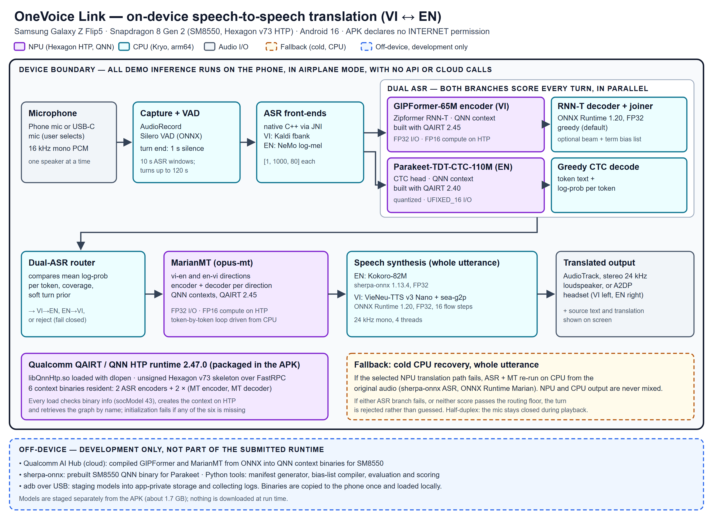

### 3.2 Architecture of the demonstrated solution

*Figure 3.2. OneVoice Link on a Samsung Galaxy Z Flip5 (Snapdragon 8 Gen 2, SM8550, Hexagon v73). Purple stages run on the Hexagon NPU through QNN; teal stages run on the CPU. Everything inside the device boundary runs on the phone. The blue box lists development tools that are not part of the submitted runtime.*

**Implementation notes.**

*Component connections.*

- **Capture.** One person speaks at a time. The phone microphone or a USB-C microphone, chosen on the dashboard, records 16 kHz mono audio. Silero VAD ends a turn after 1 s of silence.
- **Speech recognition.** Both recognizers process every turn concurrently, because the app is not told which language is being spoken:
  - Vietnamese uses the GIPFormer-65M encoder on the NPU, followed by the RNN-T decoder and joiner on the CPU.
  - English uses Parakeet-TDT-CTC-110M on the NPU, followed by greedy CTC decoding on the CPU.
- **Routing.** A CPU router compares each branch's average log-probability per emitted token, together with token coverage and a soft prior from the previous turn. It chooses the translation direction or rejects the turn.
- **Translation.** MarianMT (Helsinki-NLP opus-mt-vi-en and opus-mt-en-vi), encoder and decoder, runs on the NPU.
- **Speech output.** The CPU renders the translated speech in one pass for the whole utterance:
  - English: Kokoro-82M.
  - Vietnamese: VieNeu-TTS v3 Nano, with sea-g2p converting text to phonemes.
- **Playback.** Output plays through the loudspeaker, or through a connected Bluetooth A2DP headset with Vietnamese on the left channel and English on the right. The source text and the translation are also shown on screen.
- **Half-duplex.** Capture and playback never overlap: the microphone stays closed while a turn is processed and played.
- **Long turns.** Turns longer than 10 s are recognized and translated in 10 s windows while the person is still speaking, up to 120 s.

*Runtimes and versions.*

- **NPU runtime.** QAIRT/QNN HTP 2.47.0 is packaged in the APK and loaded with `dlopen`. It uses the unsigned Hexagon v73 skeleton over FastRPC.
- **Context binaries.** Six are resident in memory: two ASR encoders, plus one MT encoder and one MT decoder per direction. GIPFormer and Marian were compiled with QAIRT 2.45; Parakeet with QAIRT 2.40.
- **Load checks.** For each context, the app reads its binary info (`socModel` 43), creates the context on the HTP and retrieves its graph by name. The app does not start unless all six load.
- **CPU runtimes.** ONNX Runtime 1.20.0 runs the RNN-T decoder and joiner, VieNeu and Silero VAD. sherpa-onnx 1.13.4 runs Kokoro. The feature front-ends are native C++ called through JNI.

*Precision and quantization.*

| Component | Where it runs | Input/output | Compute |
|---|---|---|---|
| GIPFormer encoder | NPU | FP32 | FP16 on the HTP |
| MarianMT encoder and decoder | NPU | FP32 | FP16 on the HTP |
| Parakeet encoder | NPU | 16-bit unsigned fixed point (UFIXED_16); the app quantizes the input with the scale and offset stored in the binary | Quantized |
| RNN-T decoder and joiner, Kokoro, VieNeu | CPU | FP32 | FP32 |

*User controls.*

- **Load Hybrid Pipeline** loads all models.
- **Start / Stop Translating** opens and closes the microphone.
- A selector chooses the phone microphone or a USB-C microphone.

There is no language selector: the router chooses the direction for each turn.

*Fallbacks.*

- **Recognition or routing failure.** If either recognizer fails, or neither confidence score passes the acceptance floor, the turn is rejected and nothing is played. The system does not guess.
- **Translation failure.** If the NPU translation path fails after a direction has been chosen, recognition and translation are rerun on the CPU from the original audio, using sherpa-onnx ASR and ONNX Runtime Marian. The output then comes entirely from the CPU path; NPU and CPU partial results are never combined.
- **Missing NPU model.** There is no CPU-only mode. If an NPU model fails to load, the app refuses to start.

*On-device only.*

- The demo runs in airplane mode.
- The APK does not declare the Android INTERNET permission, so it cannot reach a network even if one is available.
- No inference step calls an API or a cloud service.
- Model files (about 1.7 GB) are copied once into the app's private storage and loaded locally.

*Development tools versus the submitted runtime.*

- Qualcomm AI Hub was used only at development time, to compile GIPFormer and MarianMT from ONNX into QNN context binaries for SM8550.
- The Parakeet binary is sherpa-onnx's prebuilt SM8550 build.
- Python tools on a PC generate the model manifest, compile the term bias list and score evaluations.
- adb over USB stages models onto the phone and collects logs.

None of these tools is present on the phone or used at run time.
