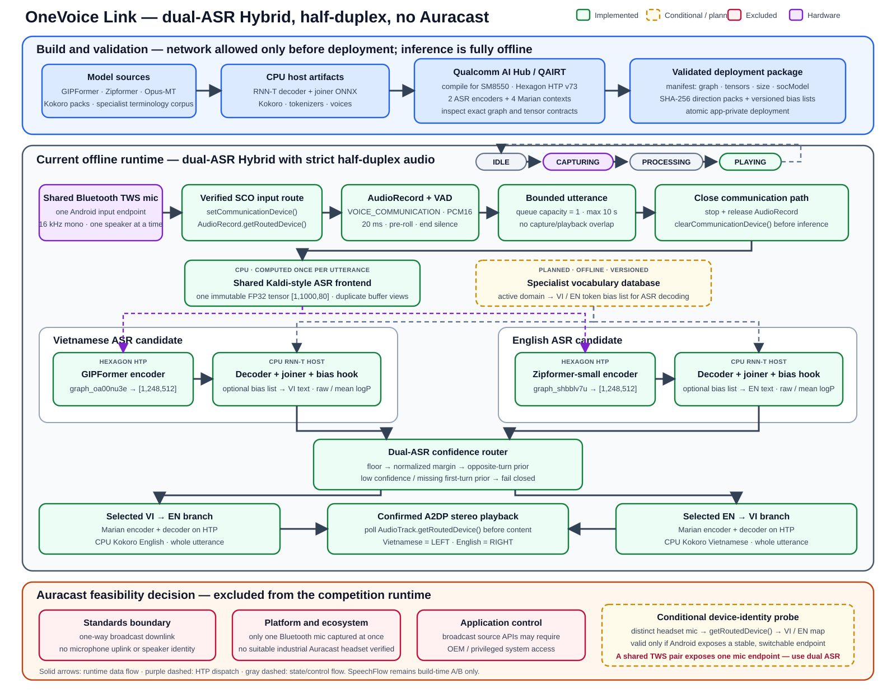

# OneVoice Challenge — Sections 5.1, 5.2 and 6

> Proposal text structured for the organizer's `1V_P2_TechProposal_Template.pdf`.
> Measured acceptance items are explicitly marked rather than presented as
> completed prototype results.
> This version uses **Opus-MT/Marian rather than Qwen3-4B** for machine
> translation. That model decision removes the 12 GB/flagship-LLM constraint and
> allows an older exact-hosted Snapdragon 8-series phone to remain a credible
> cost candidate, subject to measured performance and current supplier quotes.
>
> Evidence labels used below: **Published** = vendor or public Qualcomm AI Hub
> data; **Project** = verified in this repository; **Reference** = public model
> benchmark, not a OneVoice end-to-end result; **Budget** = engineering target
> or allocation that must be measured on the integrated prototype.

---

## 5. Hardware & Device Concept

### 5.1 Platform Selection & Justification

#### Platform decision

OneVoice Link **provisionally selects** a **Samsung Galaxy S23 8 GB/256 GB with
Snapdragon 8 Gen 2 (SM8550)** as the competition and pilot
reference device. The choice is driven by total cost subject to acceptance
gates, not by choosing the newest SoC:

- **Project evidence:** the current bidirectional VI↔EN Opus-MT artifacts are
  approximately **123 MB per direction (246 MB total)**, while the complete
  bidirectional HF development pack is approximately **1.6 GB on disk**. This
  makes 8 GB a credible candidate rather than proving sufficiency: artifact size
  is not peak RAM, so process RSS and Android low-memory-killer behavior remain
  hardware-freeze gates; see
  [HF_INTEGRATION_REPORT.md](../HF_INTEGRATION_REPORT.md).
- **QAI Hub evidence:** the public
  [Whisper-Small-Quantized card](https://aihub.qualcomm.com/models/whisper_small_quantized)
  and the official
  [OpusMT En→Zh reference card](https://aihub.qualcomm.com/models/opus_mt_en_zh)
  both list the **Galaxy S23 / Snapdragon 8 Gen 2**. The latter is architectural
  evidence that a split Marian encoder/decoder is suitable for the HTP; it is
  **not** a benchmark of OneVoice's custom VI↔EN or EN↔VI weights. Qualcomm's
  current catalog contains packaged OpusMT recipes for EN↔ES and EN↔ZH, not
  VI↔EN; the Vietnamese pair remains a bring-your-own-model compile/profile
  gate rather than a prevalidated catalog claim. As an architecture reference,
  Qualcomm's packaged EN→ZH model placed every reported layer on the S25 NPU
  and measured [2.24 ms for its encoder and 2.56 ms per decoder step](https://raw.githubusercontent.com/qualcomm/ai-hub-models/refs/tags/v0.58.0/src/qai_hub_models/models/opus_mt_en_zh/perf.yaml)
  (jobs `jp4w06x8g` / `jpx12873g`);
  these values are not extrapolated to Vietnamese, S23 or whole-sentence latency.
- **Hosted-device evidence:** the Workbench export supplied by the team on
  3 August 2026 lists the Galaxy S23 as an exact mobile device with Android 13,
  QNN support, FP16 support and HTP v73; the relevant rows and a reproducible
  refresh command are preserved in the
  [device-evidence audit](evidence/qai_hub_device_evidence_2026-08-03.md).
  Qualcomm defines a device without a `(Family)` or `(Proxy)` suffix as an exact
  hosted target in its
  [device-selection documentation](https://workbench.aihub.qualcomm.com/docs/hub/devices.html).
- **Procurement evidence:** no current, verifiable Galaxy S23 price is used in
  this revision. The expired retailer listing and all totals derived from it
  have been removed; handset cost remains a written-quotation gate, while a
  formally allocated team/sponsor unit is shown only as a conditional cash-cost
  scenario.

#### Candidate screening

The shortlist is restricted to exact-hosted commercial phones that OneVoice can
procure and deploy. It starts with the Galaxy S22 because this is the first
Galaxy generation in the team-supplied export whose exact phone row supports
both QNN and FP16; older Galaxy rows lack FP16 in that snapshot. Reference
designs, `(Family)` targets and `(Proxy)` targets are not treated as purchased
exact phones, and metrics from them are not mapped to an unlisted retail model.

No single public Qualcomm performance table contains a comparable exact-device
ASR row for all five shortlisted generations. The normalized reference below is
**Whisper-Small-Quantized W8A16**, `PRECOMPILED_QNN_ONNX`, ONNX Runtime 1.27.1
and QAIRT `2.45.0.260326154327` from AI Hub Models **v0.59.0**. It reports exact
Galaxy S22, S24, S25 and S26 rows with every reported layer on the NPU, but only
lists S23 as supported and publishes no S23 performance row.

To give S23 an exact-device feasibility reference without fabricating or
interpolating a W8A16 result, the S23 and S24 cells also cite Qualcomm's older,
commit-pinned **float Whisper-Small** v0.37 QNN-context profile. Its S24 row is a
same-model bridge for the S23→S24 decision. This is not the deprecated
Whisper-Small-V2 model, and the float rows are **not ranked against the v0.59.0
W8A16 rows**: precision, graph revision, runtime and QAIRT version differ. The
model card defines encoder latency as time to first token for an 80 × 3,000
input representing up to 30 seconds, and decoder latency as time per additional
token at a maximum decoded length of 200. Neither reference includes VAD/chunk
wait, feature extraction, Opus-MT, TTS, audio I/O, headset routing, thermal soak
or OneVoice orchestration.

| Candidate | Workbench Hosted Devices evidence | Public ASR reference: encoder / decoder step | Procurement status | Decision |
|---|---|---:|---:|---|
| **Snapdragon 8 Gen 1 — Galaxy S22 5G** | **Exact hosted phone**; Android 12/13, QNN + FP16, HTP v69 | **Current W8A16:** [305.200 ms / 10.081 ms/token](https://github.com/qualcomm/ai-hub-models/blob/v0.59.0/src/qai_hub_models/models/whisper_small_quantized/perf.yaml); jobs `j5m8n3kwp` / `jgnk63qrg`; 100% reported layers on NPU | Current written quote required | Not selected: older platform has weaker battery/thermal evidence and no demonstrated cost advantage over S23 |
| **Snapdragon 8 Gen 2 — Galaxy S23 8/256** | **Exact hosted phone**; Android 13, QNN + FP16, HTP v73; public Whisper and OpusMT cards list it | **Exact-device feasibility only:** [float v0.37: 134.534 ms / 12.050 ms/token](https://huggingface.co/qualcomm/Whisper-Small/blob/00c8c7f90d36cbb19f92cd85c65f09d95e77cafa/README.md); jobs `jpyjx0drp` / `jp02j7r25`; 100% NPU. **Current W8A16 has no public S23 performance row, so this value is not ranked with the other four** | **Current written quote required**; 0 VND incremental only if a unit is formally allocated | **Provisionally selected — compute is plausible, but exact current ASR, cost, thermal and battery gates remain open** |
| **Snapdragon 8 Gen 3 — Galaxy S24 (Snapdragon SKU)** | **Exact hosted phone**; Android 14, QNN + FP16, HTP v75 | **Current W8A16:** [274.961 ms / 6.172 ms/token](https://github.com/qualcomm/ai-hub-models/blob/v0.59.0/src/qai_hub_models/models/whisper_small_quantized/perf.yaml); jobs `jg9dlwql5` / `jp164em25`. **Same-model float bridge:** [102.365 ms / 9.634 ms/token](https://github.com/qualcomm/ai-hub-models/blob/v0.37.0/qai_hub_models/models/whisper_small/perf.yaml); jobs `jp8mxv7z5` / `jgkq4myyg`; all reported layers on NPU | Current quote and exact SM8650 SKU verification required | Best balanced upgrade if S23 misses a compute/thermal gate: the float bridge is 23.9%/20.0% lower-latency than S23; not every regional S24 is Snapdragon |
| **Snapdragon 8 Elite — Galaxy S25 12/256** | **Exact hosted phone**; Android 15, QNN + FP16, HTP v79 | **Current W8A16:** [229.540 ms / 4.700 ms/token](https://github.com/qualcomm/ai-hub-models/blob/v0.59.0/src/qai_hub_models/models/whisper_small_quantized/perf.yaml); jobs `j5qv63d4g` / `jgllv3q8g`; 100% NPU | Samsung Vietnam publishes a **22.99M VND starting/list price** for 256 GB; this is not a procurement quotation | Not selected: performance/memory fallback if S23/S24 cannot pass the cascade gates, not an energy or cost default |
| **Snapdragon 8 Elite Gen 5 — Galaxy S26 class** | **Exact hosted S26/S26+/Ultra phones**; Android 16, QNN + FP16, HTP v81 | **Current W8A16:** [174.716 ms / 3.937 ms/token](https://github.com/qualcomm/ai-hub-models/blob/v0.59.0/src/qai_hub_models/models/whisper_small_quantized/perf.yaml); jobs `jgk8e3w2g` / `j5qv63x4g`; 100% NPU | Current written quote and exact Snapdragon regional SKU required | Not selected: reference ASR is faster than S25, but there is no demonstrated OneVoice need or whole-pipeline energy saving |

The four comparable rows and the S23 coverage gap are preserved in the
[v0.59.0 performance snapshot](https://github.com/qualcomm/ai-hub-models/blob/v0.59.0/src/qai_hub_models/models/whisper_small_quantized/perf.yaml);
the separate exact-S23/S24 float bridge is preserved in Qualcomm's
[v0.37 performance snapshot](https://github.com/qualcomm/ai-hub-models/blob/v0.37.0/qai_hub_models/models/whisper_small/perf.yaml).
Public job pages may require owner/share permission, so the stable pinned files
are the primary citations and job IDs are retained only for audit. Full model,
runtime, layer-count and comparability details are in the
[NPU/ASR/power evidence audit](evidence/npu_asr_power_evidence_2026-08-03.md).

#### NPU evidence without fabricated TOPS

Qualcomm does not publish an absolute mobile NPU TOPS rating for these five
platforms. Qualcomm's generation claims are retained below as **vendor “up to”
indicators**, not multiplied across generations and not converted into TOPS.
For a common third-party signal, the table also reports one public submission
per generation using Geekbench AI 1.7.0, Android 16, TensorFlow Lite and the QNN
backend. Overall half-precision/quantized scores are shown beside the
machine-translation HP throughput so that no single generic workload is treated
as the NPU's specification.

| Platform | Qualcomm-published NPU indicator versus predecessor | Independent QNN overall HP / quantized; MT-HP throughput |
|---|---|---:|
| **8 Gen 1 / S22** | [Up to 4× AI performance versus Snapdragon 888](https://www.qualcomm.com/smartphones/products/8-series/snapdragon-8-gen-1-mobile-platform) | [11,533 / 29,733; 55.6 IPS](https://browser.geekbench.com/ai/v1/453684) |
| **8 Gen 2 / S23** | [Up to 4.35× on the cited model-dependent case and up to 60% better INT4 performance/W versus 8 Gen 1](https://www.qualcomm.com/smartphones/products/8-series/snapdragon-8-gen-2-mobile-platform) | [16,434 / 40,204; 64.7 IPS](https://browser.geekbench.com/ai/v1/511278) |
| **8 Gen 3 / S24 Snapdragon** | [Hexagon NPU up to 98% faster and up to 40% better performance/W versus 8 Gen 2](https://www.qualcomm.com/smartphones/products/8-series/snapdragon-8-gen-3-mobile-platform) | [22,716 / 55,988; 82.6 IPS](https://browser.geekbench.com/ai/v1/532146) |
| **8 Elite / S25** | [Hexagon NPU up to 45% faster and up to 45% better performance/W versus 8 Gen 3](https://www.qualcomm.com/smartphones/products/8-series/snapdragon-8-elite-mobile-platform) | [28,780 / 71,800; 115.7 IPS](https://browser.geekbench.com/ai/v1/440160) |
| **8 Elite Gen 5 / S26 class** | [NPU up to 37% faster and up to 16% better performance/W versus 8 Elite](https://www.qualcomm.com/smartphones/products/8-series/snapdragon-8-elite-gen-5) | [32,412 / 81,993; 111.0 IPS on S26 Ultra](https://browser.geekbench.com/ai/v1/447939) |

Each link is a single public burst run, not a controlled sustained laboratory
average. Geekbench's MT model is not OneVoice's Opus-MT VI↔EN graph, and its
accuracy field is not BLEU/COMET. The S26 result is additionally an Ultra phone
and identifies the QNN device only as `Qualcomm ARMv8`; it is secondary evidence,
not a clean base-S26 comparison. The S25-to-S26 MT reversal illustrates why
generic NPU scores cannot replace exact model profiling; see the
[Geekbench workload methodology](https://www.geekbench.com/doc/geekbench-ai-workloads.pdf).

#### Power and thermal evidence instead of invented TDP

Qualcomm does not publish a comparable SoC TDP for these mobile platforms.
Where credible third-party data exist, the following records **whole-device
input power and sustained-load behavior**, not SoC or NPU power:

| Candidate | Independent evidence | Feasibility interpretation |
|---|---|---|
| **S22 Snapdragon** | [DXOMARK's exact Snapdragon battery test](https://www.dxomark.com/samsung-galaxy-s22-snapdragon-battery/) reports a 3,700 mAh cell, 39 h in its moderate-use protocol and high discharge currents overall; no comparable NPU/SoC W value is published | Lowest battery capacity and weaker sustained-efficiency evidence; reject unless a verified price advantage is large and the exact OneVoice soak/rundown still passes |
| **S23 Snapdragon** | [Notebookcheck](https://www.notebookcheck.net/Samsung-Galaxy-S23-review-The-small-S23-smartphone-makes-the-biggest-leap.700018.0.html) measured 4.26 W average / 6.16 W maximum whole-phone input at load and 68.6% / 53.8% Wild Life / Extreme stability | Plausible cost baseline, but the 5.60 W kit target and eight-hour claim have little margin and remain measurement gates |
| **S24 Snapdragon** | No comparable exact base-S24 Snapdragon power review was found. [S24 Ultra](https://www.notebookcheck.net/Samsung-Galaxy-S24-Ultra-review-The-ultimate-smartphone-becomes-an-AI-smartphone.809187.0.html), using the same SoC in a larger chassis, measured 16.52 / 16.58 W and 46.1% / 56.4% stability | SoC-level thermal-risk proxy only; it must not be assigned to the base S24. Exact SKU power/thermal testing is mandatory before an upgrade |
| **S25 Snapdragon** | [Notebookcheck](https://www.notebookcheck.net/Samsung-Galaxy-S25-review-The-star-among-compact-smartphones-is-losing-ground.989246.0.html) measured 13.33 / 16.38 W and 52.7% / 47.5% stability; its Burnout run overheated | More AI headroom does not guarantee lower whole-system power or better sustained latency; use only after S23/S24 fails a gate |
| **S26 Ultra Snapdragon** | [Notebookcheck](https://www.notebookcheck.net/Blocks-prying-eyes-Samsung-Galaxy-S26-Ultra-review.1278349.0.html) measured 14.91 / 16.58 W and reported material throttling under sustained load | Latest NPU headroom is not evidence of lower end-to-end energy; cost and exact-device OneVoice measurements still govern |

Notebookcheck measures at the primary side of the power supply with a Metrahit
meter, so its figures include the complete phone and conversion losses. Test
workloads and review dates also differ. The values are therefore used only to
bound feasibility and design acceptance tests—not to rank NPU efficiency or to
claim a Snapdragon TDP; see its
[test methodology](https://www.notebookcheck.net/How-does-Notebookcheck-test-laptops-and-smartphones-A-behind-the-scenes-look-into-our-review-process.15394.0.html).

The non-phone **QCS6490/RB3 Gen 2** was also screened because Qualcomm publishes
**12 TOPS** for the
[QCS6490](https://www.qualcomm.com/internet-of-things/products/q6-series/qcs6490).
It is rejected for this phase: it requires a carrier/enclosure, audio codec,
battery, display, power-management integration and certification, while the
project requirement is a phone connected to a headset. Those integration costs
and schedule risks outweigh the value of a custom board for a competition-scale
deployment.

#### Template comparison table

Qualcomm does not publish an absolute mobile NPU TOPS value or a comparable SoC
TDP for these two mobile platforms. The defensible comparison therefore uses
official relative claims, separately tagged current-W8A16 and historical-float
ASR references, same-version independent QNN workload results and whole-device
measurements;
unpublished TOPS/TDP values and missing ASR rows are not fabricated.

| Criteria | **Option A — Snapdragon 8 Gen 2 / Galaxy S23 8/256** | **Option B — Snapdragon 8 Elite / Galaxy S25 12/256** | Selected? |
|---|---|---|---|
| **NPU Performance (TOPS)** | Absolute TOPS not published. Qualcomm's workload-dependent claim is up to 4.35× AI and up to 60% better INT4 performance/W versus 8 Gen 1; independent QNN overall HP/quantized scores are 16,434/40,204. | Absolute TOPS not published. Qualcomm claims up to 45% faster NPU and 45% better NPU performance/W versus 8 Gen 3; independent QNN overall HP/quantized scores are 28,780/71,800. | **A ✓ provisional:** B has more headroom, but A must first be tested against the actual SLA |
| **ASR feasibility** | Exact S23 **float v0.37** reference: **134.534 ms encoder / 12.050 ms per decoder step**, with 100% reported layers on NPU. Current v0.59 W8A16 lists S23 support but publishes no S23 performance row, so the final graph must be rerun. | Exact S25 **W8A16 v0.59** reference: **229.540 ms / 4.700 ms**, with 100% reported layers on NPU. It is not compared numerically with the unlike S23 float graph. | **A ✓ provisional:** exact S23 NPU execution is evidenced; normalized and end-to-end OneVoice results are not |
| **Power Consumption (TDP)** | Mobile TDP not published. Independent exact-S23 whole-phone input is 0.57/0.74/0.83 W at idle and 4.26 W average / 6.16 W maximum at generic load; **5.60 W active / 0.43 W armed-idle are phone-side project targets**, with a separate headset-battery gate. | Mobile TDP not published. Independent exact-S25 whole-phone input is 0.47/1.04/1.07 W at idle and 13.33 / 16.38 W under its review load; its stress run overheated. Review workloads differ and neither measures OneVoice. | **A ✓ provisional:** newer silicon does not establish lower phone-level energy; both options require the same test |
| **RAM / Storage Support** | 8 GB RAM + 256 GB storage; the ~1.6 GB on-disk development pack is promising, but peak RAM/LMK must be measured. | 12 GB RAM + 256 GB storage; more headroom, but Opus-MT removes the 3B+ LLM memory requirement. | **A ✓ provisional** |
| **AI SDK / Toolchain** | QAIRT/QNN, Hexagon HTP, exact-device Workbench profiling; official Marian/Opus architecture precedent on Snapdragon 8 Gen 2. | Same QAIRT/QNN/HTP toolchain and exact-device Workbench profiling on S25. | **A ✓ provisional** |
| **Form Factor Suitability** | 146.3 × 70.9 × 7.6 mm, 168 g, IP68; Bluetooth communication-headset baseline. | 146.9 × 70.5 × 7.2 mm, 162 g, IP68; equally suitable but not necessary on form factor alone. | **A ✓ provisional** |
| **Compute procurement cost** | **TBD — three current written quotes required; no expired listing is used.** A verified team/sponsor unit may reduce incremental cash cost to zero. | Samsung Vietnam publishes a **22.99M VND starting/list price** for 256 GB, not a current like-for-like procurement quote. | **A ✓ provisional** |

#### Final justification and form factor — template response (2 sentences)

We **provisionally select** the **Galaxy S23 8/256 with Snapdragon 8 Gen 2** because the lightweight Opus-MT stack does not require flagship-LLM memory, the S23 is an exact HTP v73 Workbench target, and newer exact-hosted phones are retained only as measured fallbacks; final selection also requires a current written handset quote below the next passing candidate. The product is a dedicated handheld/chest-lanyard interpreter: the bare handset is **146.3 × 70.9 × 7.6 mm, 168 g and IP68** ([Samsung official specification](https://image-us.samsung.com/SamsungUS/samsungbusiness/mobile/phones/galaxy-s/hhp-s23-spec-vzw_apr23.pdf)), while the camera-obscuring rugged shell and breakaway lanyard target **≤160 × 80 × 16 mm and ≤230 g**; drop/ESD claims will be made only after the selected accessory is certified and tested.

#### Hardware freeze rule

The S23 selection becomes final only when the complete OneVoice graph set passes
all of the following on the exact commercial handset. This preserves the cost
principle: **buy more silicon only when a measured failure requires it**.

1. QAI Hub compile/link/profile succeeds for every static ASR, Opus-MT and TTS
   graph on Snapdragon 8 Gen 2, with no unintended CPU fallback.
2. End-to-end **p95 user-perceived latency ≤1.5 s** for the competition utterance
   set, ASR/TTS real-time factor below 1.0, and an MT latency/tokens-per-second
   gate defined for the fixed evaluation sequence length.
3. No low-memory kill and at least 20% system-memory headroom after the active
   language pair is warm-loaded.
4. A 60-minute continuous thermal soak changes p95 latency by no more than 10%.
5. The integrated phone plus wireless headset passes the §5.2 eight-hour shift
   rundown.
6. A dated written quote confirms that the complete S23 kit costs less than the
   next hardware candidate that passes Gates 1–5; otherwise the cheaper passing
   candidate is selected.

If only the battery gate fails because of cell degradation, evaluate authorized
battery service; if the workload itself exceeds the energy envelope, qualify the
Galaxy S23+ (same Snapdragon 8 Gen 2, 4,700 mAh) or another higher-energy handset
with the same full rundown rather than assuming capacity alone guarantees a
pass. The [independent S23+ review](https://www.notebookcheck.net/Samsung-Galaxy-S23-smartphone-review-The-better-Galaxy-S23.700333.0.html)
still reports sustained throttling, so it is an **energy-capacity fallback, not
a thermal upgrade**. If compute or thermal gates fail, profile the Snapdragon
S24 SKU next and use S25 only if that second gate also fails.

---

### 5.2 Key Hardware Components & Power Budget

#### Wireless headset baseline and selection

The baseline is a **bidirectional Bluetooth communication headset with both a
microphone and earpiece(s)**, paired directly to the Galaxy S23. There is no
audio cable between the worker and phone during operation. The phone will use a
communication route—Bluetooth Classic HFP/mSBC for the initial candidates, or
LE Audio/LC3 only after exact phone-headset validation—because A2DP alone is a
playback profile and cannot provide the required microphone uplink.

OneVoice prioritizes a **close-talk MEMS microphone plus headset-side noise
suppression and wind-noise processing**. MEMS describes the transducer; it does
not by itself prove noise cancellation. The procurement gate therefore tests
the complete microphone placement, DSP, Bluetooth codec and ASR result. In a
zone where occupational hearing protection is mandatory, the site's PPE rating
and fit assessment take precedence over microphone technology: an unrated
on-ear headset must not be worn under an earmuff if it breaks the protector's
seal.

| Wireless candidate | Published evidence | Construction-site interpretation | Decision |
|---|---|---|---|
| **[Elgin Discord](https://elginusa.com/products/ruckus-discord-wireless-noise-cancelling-earbuds)** | Manufacturer lists a noise-isolating **MEMS** microphone, Bluetooth 5.3 with HFP/HSP/A2DP, IP65, ANSI-certified **31 dB NRR**, and up to 14 h playback | Only candidate here that combines a published MEMS microphone with a published occupational attenuation rating. The 14 h value is not a continuous microphone/OneVoice result, and the single omnidirectional mic still needs high-noise ASR testing. | **Provisional cost-first prototype baseline**, conditional on an authentic local quote, compatible certification for the deployment country, fit test and the audio gates below |
| **[Jabra Perform 75](https://www.jabra.com/_/media/Jabra_VXi_Product-Documentation/Jabra-Perform-75/Technical-specifications/RevC/EN-Perform-75-Tech-Sheet-NA-SKUs-011225.pdf)** | Official sheet lists **2 × MEMS**, call and wind-noise reduction, HFP 1.8/mSBC, Bluetooth 5.3, IP65 and up to 20 h talk time | Strongest disclosed dual-MEMS speech candidate, but Jabra positions it for retail/frontline work and publishes no EN 352/NRR hearing-protection rating. | Speech-quality fallback only for zones where a separate occupational assessment says integrated hearing protection is not required |
| **[ISOtunes ULTRACOMM Aware](https://isotunes.eu/products/ultracomm-aware)** | Detachable noise-isolating boom, Bluetooth 5.2, EN 352, **SNR 30 dB**, 82 dB output limit, IP67 without/IP56 with boom, and up to 10 h battery life | Cost-oriented industrial/PPE alternative with situational-awareness mode. The manufacturer does not identify the speech boom as MEMS, and the 10 h claim leaves less shift margin. | High-noise deployment fallback if the cost-first MEMS candidate fails safety, fit or ASR gates |
| **[3M PELTOR WS ALERT XP+](https://multimedia.3m.com/mws/media/2523608O/3m-peltor-ws-alert-xp-xpi-fm-radio-headset.pdf?fn=tds-emea-ws-alert-xp-xpi-headset.pdf)** | Noise-cancelling **electret** boom, Bluetooth 5.2/HFP 1.8 MultiPoint, EN 352, **SNR 29–30 dB**, and up to 78 h streaming | Strongest disclosed runtime and established construction/PPE form factor, but it deliberately does not satisfy the MEMS preference. The cheaper XP+ is sufficient; OneVoice does not need XPI+-only audio-profile controls. | Safety/runtime fallback when the site PPE assessment requires this class or cheaper candidates fail |

The final headset is the **lowest landed-cost candidate** that satisfies the
site's PPE rules and all of these measured gates: bidirectional Bluetooth
reconnection without user intervention; mono 16 kHz capture available to the
app; no route loss during screen-off operation; headset runtime at least 10 h in
the scripted lab cycle and at least 8 h in the field shift; and no more than a
10% relative WER increase from 85 to 90 dBA or a 20% relative increase from 85
to 95 dBA on the fixed OneVoice noisy-speech set. These thresholds are project
acceptance criteria, not vendor claims. Full provenance is recorded in the
[wireless-headset evidence audit](evidence/wireless_headset_evidence_2026-08-03.md).

#### Phone and headset power table

The watt figures below are **budget allocations, not Qualcomm/Samsung TDP
claims**. Qualcomm AI Hub reports inference latency, memory and layer placement;
it does not measure phone battery power, Bluetooth audio power or full-pipeline
energy
([AI Hub methodology](https://workbench.aihub.qualcomm.com/docs/hub/howitworks.html),
[FAQ](https://workbench.aihub.qualcomm.com/docs/hub/faq.html)). Final values will
therefore be replaced by a whole-device active/idle measurement with the chosen
wireless headset. The headset has an independent battery, so the phone and
headset runtime gates are reported separately rather than hiding headset energy
inside the phone battery calculation.

As an external sanity check, Notebookcheck measured the exact S23 at **4.26 W
average / 6.16 W maximum whole-phone input under load**, with screen-on idle
points of **0.57/0.74/0.83 W**. Those primary-side measurements include
conversion losses and use a non-AI review workload, so they are neither SoC TDP
nor battery-terminal OneVoice power. They show that 5.60 W is a plausible
engineering target, but not a guaranteed or inherently conservative ceiling;
the 0.43 W screen-off armed target also remains unmeasured.

| Component | Specification | Peak-Power Design Allocation | Notes |
|---|---|---:|---|
| **SoC Module** | Galaxy S23: Snapdragon 8 Gen 2 + Hexagon HTP + 8 GB RAM/PMIC | **4.60 W — Budget** | CPU + NPU + memory active allocation; armed-idle allocation 0.35 W. Not a vendor-published TDP. |
| **Wireless Audio I/O** | Bluetooth headset mic + earpiece(s); HFP/mSBC baseline, LE Audio only if the exact pair passes | **0.50 W — Phone-side budget** | Combined allowance for the phone Bluetooth controller, codec, capture and playback route; armed-idle allocation 0.07 W. It does not represent headset power and must be replaced by measurement. |
| **Headset Battery / DSP** | Independent rechargeable headset battery, MEMS/boom microphone DSP and local speaker amplifier | — | Vendor runtime is screening evidence only. Acceptance requires ≥10 h scripted lab runtime and ≥8 h field runtime with microphone uplink, translated playback and the production reconnect policy. |
| **Battery** | Integrated **3,900 mAh typical** Li-ion battery | — | Target: >8 h continuously armed shift at ≤20% active translation duty; battery state-of-health must be ≥90%. |
| **Storage** | 256 GB internal storage | **0.05 W — Budget** | OS, app, signed QNN contexts and all required language packs; armed-idle allocation 0.01 W. Current development model pack is ~1.6 GB. |
| **Display (optional during translation)** | 6.1-inch AMOLED; dark UI, 60 Hz; screen off when armed | **0.45 W — Budget** | Display-off is the hands-free baseline; the peak allocation covers transcript review. |
| **Total Phone Budget** | Phone while connected to wireless headset | **5.60 W active; 0.43 W armed-idle** | Phone-side engineering target pending exact measurement. The headset has a separate runtime gate; neither eight-hour claim is yet a prototype result. |

#### Battery-life derivation

Samsung publishes the 3,900 mAh typical capacity, but not a comparable
whole-device OneVoice power figure. For planning only, assume 3.85 V nominal and
a 10% usable-energy guard band:

```text
Usable energy at 100% battery health
  E = 3.9 Ah × 3.85 V × 0.90 = 13.51 Wh

Average power at 20% active translation / 80% armed-idle
  Pavg = 0.20 × 5.60 W + 0.80 × 0.43 W = 1.464 W

Planned runtime at 100% battery health
  t = 13.51 Wh / 1.464 W = 9.23 h

Acceptance-floor runtime at 90% battery health
  t90 = (13.51 Wh × 0.90) / 1.464 W = 8.31 h
```

At 90% battery state-of-health, an eight-hour shift permits average power of
only `12.16 Wh / 8 h = 1.520 W`. With the 5.60 W active ceiling and 20% active
duty, the measured screen-off armed state must therefore be approximately
**0.50 W or lower**. The 0.43 W project target produces only a 0.31-hour nominal
margin.

The independent review's exact-S23 idle points provide a deliberately cautious
sensitivity bracket. They are screen-on/generic laboratory states, whereas
OneVoice plans screen-off capture with the Bluetooth communication route held,
so they are not substituted as measurements of OneVoice armed idle:

| 20% active / 80% armed-idle scenario | Armed-idle value used | Average power | Runtime at 90% SOH | Planning result |
|---|---:|---:|---:|---|
| **Project design target** | **0.43 W** | **1.464 W** | **8.31 h** | Nominal pass, narrow margin |
| Exact-S23 minimum-idle sensitivity | 0.57 W | 1.576 W | 7.72 h | Fail sensitivity case |
| Exact-S23 average-idle sensitivity | 0.74 W | 1.712 W | 7.10 h | Fail sensitivity case |

At the same 5.60 W active ceiling, an armed-idle result of 0.57 W reduces the
maximum passing active duty to about 18.9%; 0.74 W reduces it to about 16.1%.
The result is therefore **battery-feasible in the nominal model but high-risk
and unresolved in hardware**, not a demonstrated eight-hour runtime.

This is **continuous all-shift availability of both the phone and independently
powered headset at a 12-minutes-per-hour active duty cycle**, not eight hours of
uninterrupted peak inference. The 20% duty cycle is a design scenario that still
requires pilot evidence; it is not assumed to represent every factory role.

| Active translation duty | Average power | Runtime at 100% SOH | Runtime at 90% SOH | Result against 8 h target |
|---:|---:|---:|---:|---|
| 15% | 1.206 W | 11.20 h | 10.09 h | Pass in planning model |
| **20% design scenario** | **1.464 W** | **9.23 h** | **8.31 h** | Pass, narrow margin at 90% SOH |
| 30% | 1.981 W | 6.82 h | 6.14 h | Fail |
| 50% | 3.015 W | 4.48 h | 4.03 h | Fail |
| 100% | 5.600 W | 2.41 h | 2.17 h | Fail |

The final claim requires an eight-hour scripted rundown on the commercial S23
with the production model pack, screen policy, selected wireless headset,
Bluetooth reconnect policy, 60-minute thermal soak, measured battery health and
a field-validated active-duty distribution. The headset is charged separately
and must complete the same shift without an in-shift recharge or battery swap.
If the measured combination of active power, armed-idle power and field duty
exceeds the 1.520 W average-power envelope at 90% SOH, the base S23 fails the
battery gate and must not be described as an eight-hour device; the team must
then qualify a higher-energy handset configuration before freeze.

#### Prototype/pilot BOM

The previous refurbished-S23 listing has expired, so neither its price nor any
total derived from it is retained. Let `C_S23` be the lowest compliant, dated
written quote after verifying the exact model, condition, warranty, Bluetooth
audio and battery state-of-health. A conditional reuse scenario is shown separately;
a team/sponsor loan is not presented as a zero-value deployed asset. Accessory
values below are internal engineering budget ceilings, not supplier quotations,
and must also be replaced by dated quotes before procurement.

| BOM item | Qty. | Unit cost | Cost basis / acceptance condition |
|---|---:|---:|---|
| Galaxy S23 8/256, Snapdragon 8 Gen 2 | 1 | **`C_S23` — TBD from three current written quotes** | No expired marketplace/retailer price is used. Verify exact model, IMEI, display, Bluetooth communication audio, warranty and battery health ≥90% before acceptance. |
| Wireless headset with microphone + earpiece(s) | 1 | **`C_headset` — TBD from three current landed-cost quotes** | Quote the lowest candidate in the required PPE class. The provisional Elgin Discord must pass certification/fit, Bluetooth route, WER, latency and battery gates before freeze. |
| Replaceable ear tips/cushions, mic windscreen and hygiene kit | 1 set | **`C_hygiene` — TBD** | Include consumables required by the chosen headset and shared-use hygiene policy; do not hide recurring PPE cost. |
| Camera-obscuring rugged shell + breakaway lanyard | 1 | **≤0.60M VND — Budget ceiling** | Glove-safe, physical camera cover and secure phone retention; drop/ESD claims require evidence. |
| 25 W phone charger + headset charging cable | 1 set | **≤0.30M VND — Budget ceiling** | Off-shift charging; neither device is connected to a charger during the rundown. |
| Authorized battery service, only if SOH <90% | 0–1 | **≤0.80M VND — Contingency** | Service must restore sealing; otherwise reject the handset. |
| **Total — greenfield S23 kit** | | **`C_kit = C_S23 + C_headset + C_hygiene + C_shell/lanyard + C_charger + C_required_service`** | No total is claimed until current handset, headset and hygiene quotations exist. The fixed internal shell/charger caps add at most 0.90M VND before optional phone-battery service. |
| **Conditional incremental cash outlay with a verified loan/inventory phone** | | **`C_headset + C_hygiene + ≤0.90M VND`; add ≤0.80M VND only if service is approved** | Cash outlay only; the handset's replacement-equivalent asset value and recurring hygiene/PPE cost remain disclosed separately. |

Samsung Vietnam publishes a **22.99M VND starting/list price** for the
exact-hosted Galaxy S25 256 GB, but this is not treated as an in-stock
procurement quote or combined into a kit total. The S23 is retained only if its
dated greenfield quote is lower than a same-date, like-for-like quote for the
next candidate that passes the same performance, thermal, memory, audio and
battery tests; no absolute saving or percentage saving is claimed until those
quotes exist.

Used/refurbished procurement, if chosen, is appropriate only for the competition
prototype or small pilot and requires a supply/warranty/battery-quality gate.
Before commercial-scale procurement, the same acceptance suite will be rerun on
a current exact-hosted phone, and the cheapest passing SKU will replace the S23
without changing the QNN/Opus software architecture.

---

## 6. System Architecture & Integration

Section 6 connects the cascaded AI pipeline to the selected Snapdragon 8 Gen 2
phone and bidirectional wireless headset. The headset performs acoustic capture,
local microphone noise processing and playback; the phone performs every AI
stage. The target runtime keeps the post-Bluetooth audio path in native C++ and
uses QNN context binaries compiled for the S23's HTP; the existing ONNX/Hugging
Face backend remains a development and emulator reference only.

### 6.1 Software Stack

| Layer | Component / Framework | Role |
|---|---|---|
| **OS** | Android on Galaxy S23; app `minSdk 28`, `targetSdk 36`; `AudioManager` communication-device routing | Base runtime, `RECORD_AUDIO`/`BLUETOOTH_CONNECT`, lifecycle and selection of `TYPE_BLUETOOTH_SCO` or a validated `TYPE_BLE_HEADSET`. On the production S23 (API ≥31), `setCommunicationDevice()` selects the output and Android selects its matching input. Bluetooth route management is planned, not yet implemented in app code. |
| **AI Runtime** | Qualcomm QAIRT/QNN C API + Hexagon HTP; one QAIRT version pinned across Workbench artifacts and APK | Target: NPU execution of precompiled ASR, MT and TTS graphs. Runtime packaging/context retrieval exists; real tensor binding and graph execution remain integration work. The repository targets QNN 2.36, so ABI/runtime alignment with newer Workbench artifacts is a release gate. |
| **Audio Processing** | Google Oboe/AAudio native streams, Android `VoiceCommunication`, mono 16 kHz PCM16; HFP/mSBC baseline or validated LE Audio; planned native VAD | Oboe capture/playback, zero-fill on underrun and ring-overflow policy are implemented. Bluetooth device selection, reconnect/fail-closed behavior, actual negotiated sample rate and codec latency remain integration gates. Headset DSP and Android AEC/NS must be evaluated together to avoid harmful double processing. |
| **Model Serving** | **Planned:** SoC-specific QNN context(s): ASR → C++ tokenizer/decoder → Opus-MT/Marian encoder-decoder → TTS → explicit resampler when the TTS rate is not 16 kHz | Offline cascade target. QAI Hub's EN↔ES/EN↔ZH OpusMT recipes supply an architectural pattern; OneVoice VI↔EN/EN↔VI weights require static graph surgery, exposed cache/state, QNN compile/profile and numerical-validation jobs before they are called supported. |
| **App Layer** | C++20 `libonevoice_core.so` + lock-free SPSC rings; Kotlin/Jetpack Compose UI; four lifecycle-only JNI calls; **planned** enterprise MDM policy | Native real-time worker and lifecycle UI are implemented; production cascade orchestration and camera/radio enforcement remain release work. |

The development fallback uses **sherpa-onnx 1.13.4 + ONNX Runtime 1.20.0**.
The team's local, git-ignored model workspace contains documented INT8 Opus-MT
VI→EN and EN→VI artifacts, and the app contains a Kotlin
SentencePiece/greedy-decoder development path. That fallback is not the final
NPU serving design. The planned production path moves tokenization and
autoregressive scheduling into native C++ so the latency-sensitive cascade
preserves the project invariant that audio frames never cross JNI.

The current verified artifact set covers **VI↔EN only**. The broader VI↔ZH and
VI↔KO roadmap in
[onevoice_model_comparison.md](../docs-main/literature/onevoice_model_comparison.md)
still needs direct Opus-MT checkpoints or an explicitly benchmarked English
pivot; a pivot executes MT twice and therefore must pass its own latency and
COMET/terminology gates. The phone keeps only the active language pair warm to
bound RAM, regardless of whether the final route is direct or pivoted.

All cloud-side jobs must use one version-pinned workflow. Current Qualcomm AI
Hub guidance compiles/links the individual graphs and produces a SoC-specific
artifact; the app runtime must be upgraded and regression-tested against the
same QAIRT release rather than assuming a context built by a newer service is
compatible with the repository's current 2.36 headers/runtime. See the official
[compile documentation](https://workbench.aihub.qualcomm.com/docs/hub/compile_examples.html)
and [release notes](https://workbench.aihub.qualcomm.com/docs/hub/release_notes.html).

### 6.2 Architecture Diagram



*Figure 6.2 — Green blocks are implemented, amber dashed blocks are integration
or release gates, blue blocks run only during build/validation, and the complete
deployed path remains inside the offline wireless-headset/Galaxy S23 system; all
AI models and user data remain on the phone.*

```mermaid
flowchart LR
  subgraph BUILD["Build and validation only — Internet allowed"]
    SRC["ASR + Opus-MT + TTS checkpoints"]
    EXPORT["Static ONNX export<br/>calibration + golden vectors"]
    HUB["Qualcomm AI Hub Workbench<br/>quantize · compile · link · profile<br/>exact Galaxy S23"]
    ART["Target artifact<br/>signed, version-pinned<br/>S23 QNN context(s) + metadata"]
    SRC --> EXPORT --> HUB --> ART
  end

  subgraph HEADSET["Wireless industrial headset — independent battery"]
    MIC["MEMS or industrial boom mic<br/>local noise DSP"]
    OUT["Protected earpiece(s)<br/>translated speech output"]
  end

  subgraph PHONE["Phone runtime boundary — Galaxy S23 / Snapdragon 8 Gen 2 — no Internet"]
    HAL["Android communication route<br/>Bluetooth HFP or validated LE Audio"]
    CAP["Oboe capture callback<br/>16 kHz PCM16 — implemented"]
    RIN["SPSC input ring<br/>implemented"]
    WORK["C++ native AI worker<br/>cascade scheduler pending"]
    VAD["Native VAD / finalization<br/>pending"]
    ASR["ASR QNN graph<br/>integration pending"]
    TEXT["C++ tokenizer / decoder<br/>pending"]
    MT["Opus-MT encoder/decoder<br/>QNN graphs — integration pending"]
    TTS["TTS QNN graph<br/>integration pending"]
    RS["Rate conversion to 16 kHz<br/>pending when required"]
    ROUT["Native half-duplex gate<br/>pending; exists in HF backend"]
    ROUT2["SPSC output ring +<br/>Oboe playback — implemented"]
    HTP[("Hexagon HTP v73")]
    STORE[("App-private model directory<br/>backup/encryption release gate")]
    UI["Kotlin / Compose UI"]
    JNI["4 JNI lifecycle calls<br/>no audio frames"]

    HAL --> CAP --> RIN --> WORK --> VAD --> ASR --> TEXT --> MT --> TTS --> RS --> ROUT --> ROUT2
    ASR -. "QNN" .-> HTP
    MT -. "QNN" .-> HTP
    TTS -. "QNN" .-> HTP
    STORE --> WORK
    UI --> JNI -. "init / start / stop / destroy" .-> WORK
  end

  MIC -- "Bluetooth microphone uplink" --> HAL
  ROUT2 -- "Bluetooth speech downlink" --> OUT
  ART -. "offline signed install / MDM provisioning" .-> STORE
```

<details>
<summary>Editable Mermaid source for the architecture figure</summary>



</details>

The diagram deliberately distinguishes the implemented native audio/JNI
plumbing from Bluetooth routing and model-integration work still pending.
Qualcomm AI Hub is outside the runtime boundary: it is used to prepare and
profile artifacts, not called by the deployed application. On Android API 31+,
the app will select the validated communication device through
[`AudioManager.setCommunicationDevice()`](https://developer.android.com/reference/android/media/AudioManager#setCommunicationDevice(android.media.AudioDeviceInfo));
the framework selects its matching input. Device selection for final AI numbers
must use an **exact Galaxy S23**, not only a family/proxy target, following the
official [AI Hub device-selection guidance](https://workbench.aihub.qualcomm.com/docs/hub/devices.html).

### 6.3 Offline-First Design Principles

The following are release requirements. Items already evidenced in the
repository are identified; provisioning, backup hardening and MDM enforcement
remain acceptance work.

1. **No runtime cloud dependency.** Target release packs place ASR, Opus-MT,
   TTS, tokenizers, glossaries and QNN runtimes on-device. Qualcomm AI Hub is a
   build/profile service only; no Workbench credential or API client may ship in
   the APK.
2. **Network permission is absent.** The current production manifest requests
   audio and optional Bluetooth/P2P permissions but does **not** request
   `android.permission.INTERNET`. A planned CI assertion will fail if that
   permission or a network SDK appears.
3. **Offline language packs.** Required directions will be signed, checksummed
   and provisioned before deployment. Only the active pair remains resident;
   switching direction or pack never downloads data.
4. **SoC- and version-pinned artifacts.** Each release QNN context will be built
   for the S23 HTP and exact QAIRT version packaged by the app. Planned startup
   checks validate the manifest, graph/tensor contract and hashes before opening
   the microphone.
5. **Privacy release gate.** Raw audio, transcripts and translations must remain
   on the phone. Before making that claim, production must disable/exclude app
   data from Android backup, validate app-private storage/encryption behavior,
   and make local diagnostic logging opt-in, redacted and audio-free.
6. **Allowlisted Bluetooth audio; other networks off.** Bluetooth is required
   for the production headset, but the MDM profile disables cellular data,
   Wi-Fi, hotspot and NFC and prevents pairing to unapproved devices. The
   headset is enrolled before the shift, non-discoverable during operation and
   automatically fails closed to muted capture/playback if the approved route
   disconnects; it does not silently fall back to the phone microphone or
   speaker. Bluetooth codec latency, reconnect time, radio energy and the
   independently charged headset battery are measured as part of the kit.
7. **Deterministic failure behavior.** Implemented behavior zero-fills playback
   underrun, applies the documented input-overflow policy and retains initialized
   state across stop/start. Release work adds fail-closed handling for a
   missing/corrupt model pack with a visible text error and muted synthesis; no
   cloud or unimplemented TTS fallback is claimed.
8. **No unsafe translation cache in v1.** Reusing old translations can be unsafe
   in a factory when context changes. OneVoice may cache immutable UI assets,
   but it regenerates each safety-relevant translation locally and displays the
   source plus translated text for confirmation.

### Integration status and verification plan

| Integration item | Current evidence | Submission claim |
|---|---|---|
| Native Oboe capture/playback, SPSC rings and lifecycle-only JNI | Implemented in [`docs/ARCHITECTURE.md`](../ARCHITECTURE.md) | **Implemented** |
| QNN runtime packaging, `dlopen`, context creation and graph retrieval | Implemented in [`docs/QNN_INTEGRATION.md`](../QNN_INTEGRATION.md) | **Implemented scaffolding** |
| Bidirectional VI↔EN Opus-MT INT8 development path | ONNX artifacts and ORT/SentencePiece integration documented in [`docs/HF_INTEGRATION_REPORT.md`](../HF_INTEGRATION_REPORT.md) | **Development backend integrated; post-fix end-to-end retest still required** |
| Real OneVoice QNN context, tensor binding, quantization and `graphExecute` | Context binary absent; tensor/QnnMem mapping is not implemented; execute is a silence stub | **Integration pending — not reported as a benchmark result** |
| Offline/privacy hardening | `INTERNET` permission is absent, but the manifest still allows Android backup; MDM, backup exclusion, artifact signatures/hashes and network CI checks are not yet evidenced | **Partially implemented; release gate** |
| Bluetooth headset routing, reconnect/fail-closed behavior and negotiated format | Permissions exist in the manifest, but production `AudioManager` communication-device selection is not implemented | **Integration pending** |
| Wireless headset WER/latency, phone radio energy and separate eight-hour headset rundown | No integrated measurement in the repository | **Planned acceptance tests** |

Before submission, the team will attach:

- exact Galaxy S23 QAI Hub compile/link/profile URLs for the OneVoice models;
- the versioned graph/tensor contracts and golden vectors required by
  [MODEL_HANDOFF.md](../MODEL_HANDOFF.md);
- p50/p95 per-stage and end-to-end latency, NPU layer residency, peak memory and
  60-minute thermal-soak results;
- WER/CER, BLEU/COMET and TTS intelligibility results on clean and 85/90/95 dBA
  factory-noise sets, including each headset candidate's negotiated Bluetooth
  route and reconnect latency; and
- a whole-phone battery trace, a separate headset rundown, fit/PPE evidence and
  finalized supplier quotations for every BOM line.

---

## Primary external sources

Accessed 3 August 2026 unless a source itself states otherwise.

1. [Qualcomm AI Hub documentation — overview](https://workbench.aihub.qualcomm.com/docs/)
2. [Qualcomm AI Hub — supported devices and exact/family/proxy selection](https://workbench.aihub.qualcomm.com/docs/hub/devices.html)
3. [Qualcomm AI Hub — Whisper-Small-Quantized model card](https://aihub.qualcomm.com/models/whisper_small_quantized)
4. [Qualcomm AI Hub — OpusMT En→Zh model card and supported chipsets](https://aihub.qualcomm.com/models/opus_mt_en_zh)
5. [Qualcomm AI Hub Models — official model catalog](https://github.com/qualcomm/ai-hub-models#multimodal) and [versioned OpusMT performance data](https://raw.githubusercontent.com/qualcomm/ai-hub-models/refs/tags/v0.58.0/src/qai_hub_models/models/opus_mt_en_zh/perf.yaml)
6. [Samsung Galaxy S23 official business specification](https://image-us.samsung.com/SamsungUS/samsungbusiness/mobile/phones/galaxy-s/hhp-s23-spec-vzw_apr23.pdf)
7. [Samsung Vietnam Galaxy S25 specification and published starting price](https://www.samsung.com/vn/smartphones/galaxy-s25/specs/)
8. Qualcomm AI Hub Models versioned ASR snapshots: [Whisper-Small-Quantized v0.59.0](https://github.com/qualcomm/ai-hub-models/blob/v0.59.0/src/qai_hub_models/models/whisper_small_quantized/perf.yaml), [Whisper-Small float v0.37.0](https://github.com/qualcomm/ai-hub-models/blob/v0.37.0/qai_hub_models/models/whisper_small/perf.yaml) and [job visibility documentation](https://workbench.aihub.qualcomm.com/docs/hub/jobs.html)
9. Qualcomm mobile-platform briefs/pages: [8 Gen 1](https://www.qualcomm.com/content/dam/qcomm-martech/dm-assets/documents/snapdragon_8_gen_1_mobile_platform_product_brief_1.pdf), [8 Gen 2](https://www.qualcomm.com/content/dam/qcomm-martech/dm-assets/documents/Snapdragon-8-Gen-2-Product-Brief.pdf), [8 Gen 3](https://www.qualcomm.com/smartphones/products/8-series/snapdragon-8-gen-3-mobile-platform), [8 Elite](https://www.qualcomm.com/content/dam/qcomm-martech/dm-assets/documents/Snapdragon-8-Elite-Platform-Product-Brief.pdf) and [8 Elite Gen 5](https://www.qualcomm.com/content/dam/qcomm-martech/dm-assets/documents/Snapdragon-8-Elite-Gen-5-product-brief.pdf)
10. [Geekbench AI workload methodology](https://www.geekbench.com/doc/geekbench-ai-workloads.pdf) and QNN submissions for [S22](https://browser.geekbench.com/ai/v1/453684), [S23](https://browser.geekbench.com/ai/v1/511278), [S24](https://browser.geekbench.com/ai/v1/532146), [S25](https://browser.geekbench.com/ai/v1/440160) and [S26 Ultra](https://browser.geekbench.com/ai/v1/447939)
11. [Notebookcheck test methodology](https://www.notebookcheck.net/How-does-Notebookcheck-test-laptops-and-smartphones-A-behind-the-scenes-look-into-our-review-process.15394.0.html) and reviews of [S23](https://www.notebookcheck.net/Samsung-Galaxy-S23-review-The-small-S23-smartphone-makes-the-biggest-leap.700018.0.html), [S23+](https://www.notebookcheck.net/Samsung-Galaxy-S23-smartphone-review-The-better-Galaxy-S23.700333.0.html), [S24 Ultra](https://www.notebookcheck.net/Samsung-Galaxy-S24-Ultra-review-The-ultimate-smartphone-becomes-an-AI-smartphone.809187.0.html), [S25](https://www.notebookcheck.net/Samsung-Galaxy-S25-review-The-star-among-compact-smartphones-is-losing-ground.989246.0.html) and [S26 Ultra](https://www.notebookcheck.net/Blocks-prying-eyes-Samsung-Galaxy-S26-Ultra-review.1278349.0.html)
12. [DXOMARK — Galaxy S22 Snapdragon battery test](https://www.dxomark.com/samsung-galaxy-s22-snapdragon-battery/)
13. [Android `AudioManager` communication-device routing](https://developer.android.com/reference/android/media/AudioManager#setCommunicationDevice(android.media.AudioDeviceInfo)) and [BLE Audio recording guidance](https://developer.android.com/develop/connectivity/bluetooth/ble-audio/audio-recording)
14. [Elgin Discord official product specification](https://elginusa.com/products/ruckus-discord-wireless-noise-cancelling-earbuds)
15. [Jabra Perform 75 official technical sheet](https://www.jabra.com/_/media/Jabra_VXi_Product-Documentation/Jabra-Perform-75/Technical-specifications/RevC/EN-Perform-75-Tech-Sheet-NA-SKUs-011225.pdf)
16. [ISOtunes ULTRACOMM Aware official specification](https://isotunes.eu/products/ultracomm-aware)
17. [3M PELTOR WS ALERT XP+/XPI+ official technical bulletin](https://multimedia.3m.com/mws/media/2523608O/3m-peltor-ws-alert-xp-xpi-fm-radio-headset.pdf?fn=tds-emea-ws-alert-xp-xpi-headset.pdf)
